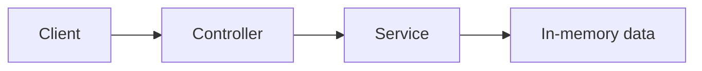

# Architecture

This document records architecture decisions as the project grows.

Do not design future infrastructure before it is required.

## Current architecture

No application architecture has been finalized yet.

The first learning phase will begin with a single Spring Boot backend.

Expected initial shape:

## Current decisions

### Monolith first

Start with a single Spring Boot application.

Reason:

The current goal is learning Spring fundamentals, not distributed systems.

### REST API

The backend will expose HTTP/JSON endpoints.

### No database initially

The first phase will use in-memory storage so Spring fundamentals can be learned before introducing JPA and PostgreSQL.

## Future decisions

Add architecture decisions here only when they are actually introduced.
