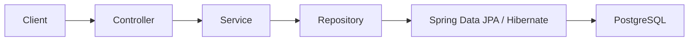

# Architecture

This document records architecture decisions as the project grows.

Do not design future infrastructure before it is required.

## Current architecture

The application is a single Spring Boot backend that exposes HTTP/JSON Project and Task APIs and persists projects and tasks in PostgreSQL.

The API supports project creation and retrieval. Tasks are created under a project and support retrieval, partial updates, deletion, paginated listing, filtering by completion status and project, simple title search, and sorting by `id`, `title`, or `completed`.

Current request flow:

## Current decisions

### Monolith first

Start with a single Spring Boot application.

Reason:

The current goal is learning Spring fundamentals, not distributed systems.

### REST API

The backend exposes HTTP/JSON project and task endpoints. Missing projects and tasks are identified in the service layer and translated to `404 Not Found` responses by centralized exception handling.

Projects are created and read through `/projects`. Tasks are created through `POST /projects/{projectId}/tasks`. `GET /tasks` returns a paginated response and supports `page`, `size`, `completed`, `projectId`, `title`, `sortBy`, and `direction` query parameters. `GET`, `PATCH`, and `DELETE /tasks/{id}` use task IDs.

### PostgreSQL persistence

Projects and tasks are stored in PostgreSQL. Every task has a non-null foreign key referencing its project.

Reason:

Projects, tasks, and their relationship must persist independently of the running application and remain available after a restart.

### Spring Data JPA and Hibernate

Spring Data JPA provides project and task repository abstractions. Hibernate maps the `Project` and `Task` entities and their one-to-many/many-to-one relationship to PostgreSQL.

The repositories use inherited persistence operations and task listing uses Spring Data JPA Specifications for composable completion-status, project, and title filters. Task creation, updates, and deletes are coordinated by the service layer in transactions. API response DTOs expose project membership without directly serializing entity relationships.

### Flyway migrations

Flyway owns database schema creation and schema history through versioned SQL migrations. Hibernate validates the schema rather than creating or changing it.

## Future decisions

Add architecture decisions here only when they are actually introduced.
