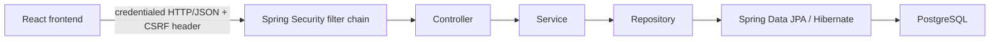

# Architecture

This document records architecture decisions as the project grows. Do not design future infrastructure before it is required.

## Current architecture

The application is a React + TypeScript frontend and a Spring Boot monolith backed by PostgreSQL. The frontend consumes HTTP/JSON authentication, project, and task APIs. A project belongs to one user and every task belongs to one project.



## Current decisions

### Monolith first

The application remains a single Spring Boot application. The goal is learning Spring fundamentals and production-style application boundaries, not distributed systems.

### REST API and persistence

The backend exposes HTTP/JSON endpoints for authentication, projects, and tasks. Tasks support creation under a project, retrieval, partial update, deletion, paginated listing, completion/project/title filtering, and sorting by `id`, `title`, or `completed`.

PostgreSQL stores `app_users`, projects, and tasks. The ownership relationship is:

```text
app_users 1 ---- * projects 1 ---- * tasks
```

Flyway owns versioned schema creation and history; Hibernate validates rather than changes the schema. Spring Data JPA repositories and service-layer transactions coordinate persistence. Task-list Specifications compose the mandatory owner predicate with existing filters, sorting, and pagination.

### Session authentication and authorization

Spring Security uses server-side HTTP sessions with an HttpOnly session cookie, not JWTs. Spring Security authenticates `POST /auth/login`, persists the `SecurityContext` in the session, and invalidates the session on `POST /auth/logout`. Passwords are BCrypt hashes; raw passwords, session identifiers, and tokens are not stored in browser storage.

`/auth/register` creates a normalized unique user and an owned Default Project in one transaction. `GET /auth/me` returns only the authenticated user's safe identity. Registration, login, and logout use API-friendly responses rather than HTML redirects.

All project and task endpoints require authentication. Controllers obtain `AppUserPrincipal` through `@AuthenticationPrincipal` and pass its stable user ID to services. Repository queries and task Specifications scope reads and writes to that owner. Tasks derive ownership from `task.project.user`; they do not have a duplicate user column. Requests for another user's project or task return `404 Not Found` to avoid revealing its existence.

### CSRF and credentialed CORS

CSRF protection remains enabled because browsers automatically send the session cookie. `GET /auth/csrf` supplies the current CSRF token and header name. The frontend sends that header for every unsafe request, including registration, login, logout, and project/task mutations, and refreshes CSRF state around authentication changes.

Centralized CORS allows only `http://localhost:5173`, enables credentials, and allows the required methods plus `Content-Type` and `X-CSRF-TOKEN`. Spring Security enables CORS so preflight requests are processed before authentication. CORS limits trusted browser origins; it does not replace authentication, authorization, or CSRF protection.

### React frontend and auth state

The separate Vite application uses React, TypeScript, TanStack Router, and TanStack Query. Typed API modules own all HTTP requests. The shared API client uses `credentials: "include"`, attaches the current CSRF header to unsafe requests, and normalizes API errors.

`GET /auth/me` is represented by one TanStack Query key, `['auth', 'me']`; there is no independent client-side authentication boolean. The task route waits for that query, renders a deliberate loading state, and redirects anonymous users to `/login`. The shared shell renders the authenticated username and logout action.

On logout, and on any protected API `401`, the frontend removes task and project queries and sets the current-user query to anonymous. This prevents one user's cached data from appearing to the next user. Session persistence is confirmed by loading `/auth/me` after a browser refresh.

### Test strategy

Backend integration tests use PostgreSQL Testcontainers with Spring Boot `@ServiceConnection`, so the authentication and ownership flows run against PostgreSQL rather than an in-memory substitute. Focused tests cover password hashing/default-project creation, anonymous access, CSRF rejection, authenticated access, cross-owner isolation, and session invalidation after logout.

## Future decisions

Add decisions only when a real requirement introduces them, such as deployment configuration, observability, CI, caching, or background work.
