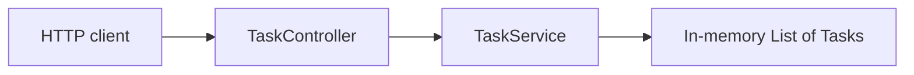

# Phase 1 Spec — Spring REST Basics

## Goal

Build a small in-memory Task REST API to learn the basic path of a request through a Spring Boot application:

```text
HTTP request -> Controller -> Service -> in-memory List<Task>
```

The goal is not to build a production-ready task system. The goal is to understand the core Spring concepts well enough to explain and implement them manually.

## Context

This is the first application phase of the Java full-stack learning project. The learner already understands programming and web APIs from TypeScript and Python, but is new to professional Java and Spring development.

The API will keep tasks in application memory. This removes database concerns so the phase can focus on:

- how a Spring Boot application starts;
- how Spring maps HTTP requests to Java methods;
- how JSON becomes Java data and Java data becomes JSON;
- how a controller delegates work to a service;
- how Spring creates and injects application objects; and
- how a Java `List` can hold application state.

All stored data is temporary. Restarting the application clears every task.

## Requirements

### Task model

A task has exactly these fields:

| Field | Type | Meaning |
| --- | --- | --- |
| `id` | numeric | Server-generated unique identifier |
| `title` | string | Description of the task |
| `completed` | boolean | Whether the task is complete |

For this phase:

- IDs start at `1` and increase for each created task.
- A newly created task always has `completed` set to `false`.
- The task list starts empty when the application starts.

### `GET /tasks`

Return every task currently stored in memory, in creation order.

Expected response when no tasks have been created:

- Status: `200 OK`
- Body:

```json
[]
```

Expected response after tasks have been created:

- Status: `200 OK`
- Body:

```json
[
  {
    "id": 1,
    "title": "Learn Spring controllers",
    "completed": false
  }
]
```

### `POST /tasks`

Create one task from a JSON request containing only a title.

Example request:

```json
{
  "title": "Learn Spring controllers"
}
```

The server must generate the ID and set `completed` to `false`. Clients must not provide these values in this phase.

Expected response:

- Status: `201 Created`
- Body:

```json
{
  "id": 1,
  "title": "Learn Spring controllers",
  "completed": false
}
```

A small request type such as `CreateTaskRequest` is appropriate because the POST input is different from a complete `Task`. Do not add mappers or a larger DTO hierarchy.

### Application flow

- The controller handles HTTP details and delegates task operations to the service.
- The service owns the in-memory `List<Task>` and the next ID value.
- The controller must not store tasks itself.
- The service must not depend on HTTP concepts such as status codes or request mappings.
- Spring should create the controller and service and connect them through constructor injection.

## Constraints

- Use one Spring Boot backend application.
- Use Spring Web MVC for the REST endpoints.
- Store tasks in an in-memory Java `List<Task>`.
- Do not use a database, JPA, Hibernate, repositories, or migrations.
- Do not add authentication or authorization.
- Do not add a frontend.
- Do not add update, delete, or get-by-ID endpoints.
- Do not add formal input validation or custom exception handling yet; these belong to Phase 2.
- Do not add interfaces with only one implementation.
- Do not add commands, mappers, facades, domain events, or other abstractions that this phase does not need.
- Do not add concurrency handling or production persistence concerns to the in-memory list.
- Verification is manual in this phase; automated tests are not required by this spec.

## Learning Objectives

By completing this phase, the learner should understand:

1. **Spring Boot startup** — what the main application class does and how `@SpringBootApplication` starts and configures the application.
2. **REST controllers** — how `@RestController`, `@RequestMapping`, `@GetMapping`, and `@PostMapping` connect HTTP requests to Java methods.
3. **Request bodies** — how `@RequestBody` asks Spring to deserialize incoming JSON into a Java object.
4. **JSON responses** — how Spring serializes returned Java objects and lists into JSON.
5. **HTTP status codes** — why a successful GET returns `200 OK` and a successful creation returns `201 Created`.
6. **Services** — why business and state-management work belongs in a service rather than in the controller.
7. **Dependency injection** — how constructor injection gives the controller its service without the controller constructing it with `new`.
8. **Spring-managed objects** — how annotations such as `@Service` and `@RestController` make classes discoverable as Spring beans.
9. **Java collections** — how a `List<Task>` stores multiple tasks and preserves their creation order.
10. **In-memory state** — why data remains available between requests but disappears when the application restarts.
11. **Layer boundaries** — how an HTTP-facing controller and application-facing service have different responsibilities.

TypeScript/Node comparison: the controller is similar to a route handler, the service is a separate application module, and Spring's dependency injection container supplies the service instead of the route module importing and constructing all dependencies itself.

## Expected Architecture

Keep all task-related code together in one feature package. Exact base package naming can be chosen when the Spring Boot project is initialized.

```text
backend/
└── src/main/java/<base-package>/
    ├── Application.java
    └── task/
        ├── Task.java
        ├── CreateTaskRequest.java
        ├── TaskService.java
        └── TaskController.java
```

Responsibilities:

| Component | Responsibility |
| --- | --- |
| `Application` | Starts the Spring Boot application |
| `Task` | Represents a task with `id`, `title`, and `completed` |
| `CreateTaskRequest` | Represents the title accepted by `POST /tasks` |
| `TaskService` | Owns the list, generates IDs, creates tasks, and returns all tasks |
| `TaskController` | Maps HTTP requests, reads request data, delegates to the service, and returns HTTP responses |



There is deliberately no repository layer. A repository will become useful when persistence is introduced in a later phase.

## Functional Acceptance Criteria

The phase is functionally complete when all of the following can be verified manually with an API client:

1. The Spring Boot application starts without errors.
2. `GET /tasks` on a fresh application returns `200 OK` and `[]`.
3. `POST /tasks` with `{"title":"Learn Spring"}` returns `201 Created`.
4. The created response contains a server-generated numeric `id`, the supplied `title`, and `completed: false`.
5. A second valid POST creates a task with a different, increasing ID.
6. `GET /tasks` returns both created tasks in creation order.
7. Restarting the application causes `GET /tasks` to return an empty list again.
8. The controller delegates storage and creation work to the service; it does not own the task list.

Invalid or missing titles are not part of this phase's acceptance checks. Validation behavior will be specified in Phase 2.

## Learning Acceptance Criteria

The phase is complete only when the learner can explain, in their own words:

1. What happens from the moment a client sends `GET /tasks` until JSON is returned.
2. What each Spring annotation used in the implementation does.
3. How Spring knows to create `TaskController` and `TaskService`.
4. How constructor injection connects the controller to the service, and why manually calling `new TaskService()` in the controller would bypass Spring's management.
5. How the POST JSON title becomes Java data.
6. How a `Task` or `List<Task>` becomes a JSON response.
7. Why task creation belongs in the service instead of the controller.
8. Where the list is stored and why it survives multiple requests during one application run.
9. Why all tasks disappear after a restart.
10. Why there is no repository, database, JPA entity, validation layer, or authentication in this phase.
11. The practical difference between `200 OK` and `201 Created` in these endpoints.

The learner should also be able to make a small change—such as renaming the request title value or adding another task through the API—and predict the resulting JSON before running the application.

## Suggested Implementation Order

Implementation should happen one meaningful step at a time:

1. Initialize and run the Spring Boot application.
2. Add the `Task` model and understand how Java exposes its data for JSON serialization.
3. Add `TaskService` with an empty list and a method that returns all tasks.
4. Add `GET /tasks` and manually verify the empty JSON array.
5. Add `CreateTaskRequest` and task creation in the service.
6. Add `POST /tasks` and return `201 Created`.
7. Manually verify creation, increasing IDs, listing, and restart behavior.
8. Review the implementation for correctness and Spring/Java misunderstandings before moving to Phase 2.
