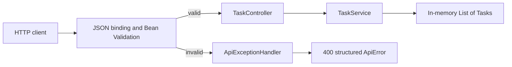

# Phase 2 Spec — API Validation and Errors

## Goal

Improve the existing in-memory Task API so that task creation has a clear HTTP input boundary, rejects invalid titles, and returns a simple structured error response.

The request flow should become:

```text
HTTP request
    -> JSON binding
    -> request validation
    -> controller
    -> service
    -> in-memory List<Task>
```

When validation fails, the request must stop before the service creates or stores a task.

This remains a learning application. The goal is to understand validation, DTO boundaries, HTTP errors, and layer responsibilities—not to build a complete production error framework.

## Context

Phase 1 introduced `GET /tasks` and `POST /tasks`, with `TaskController` delegating creation and in-memory storage to `TaskService`. It also introduced `CreateTaskRequest` because the JSON accepted when creating a task is different from a complete `Task`:

- the client supplies `title`;
- the server generates `id`; and
- the server sets `completed` to `false`.

The current API accepts a missing, `null`, empty, or whitespace-only title because request binding alone does not enforce input rules. Without validation, invalid data can reach `TaskService` and be stored.

This phase adds validation at the HTTP boundary and translates validation failures into a predictable `400 Bad Request` response. The existing in-memory behavior and successful endpoint responses should otherwise remain unchanged.

## Requirements

### Validation dependency

Add Spring Boot's validation starter to the backend Maven dependencies so Jakarta Bean Validation annotations and Spring's validation integration are available.

Do not add a validation implementation or individual validation libraries manually when the Spring Boot starter provides them.

### Create-task request DTO

Continue using `CreateTaskRequest` as the input type for `POST /tasks`.

Its `title` field must:

- be required;
- not be `null`;
- contain at least one non-whitespace character; and
- contain no more than **100 characters**.

Use Bean Validation annotations on the request DTO rather than writing title checks directly in the controller. Appropriate annotations include:

- `@NotBlank` for the required, non-empty, and non-whitespace rule; and
- `@Size(max = 100)` for the maximum length.

Use clear messages:

- `Title is required`
- `Title must be at most 100 characters`

The maximum applies to the title received from the client. Trimming or otherwise normalizing valid titles is not required in this phase.

### Triggering validation

The controller must apply `@Valid` to the `CreateTaskRequest` parameter for `POST /tasks`.

`@RequestBody` and `@Valid` have different jobs:

- `@RequestBody` asks Spring/Jackson to convert JSON into `CreateTaskRequest`;
- `@Valid` asks Spring to evaluate the validation annotations on that object.

A request DTO with validation annotations is not enough by itself; validation must be triggered at the controller boundary.

### Valid task creation

A valid request must keep the Phase 1 behavior.

Example request:

```json
{
  "title": "Learn Bean Validation"
}
```

Expected response:

- Status: `201 Created`
- Body:

```json
{
  "id": 1,
  "title": "Learn Bean Validation",
  "completed": false
}
```

The service must continue to generate the ID, set `completed` to `false`, and store the task in memory.

### Invalid task creation

Each of the following JSON requests is invalid:

Missing title:

```json
{}
```

Explicitly null title:

```json
{
  "title": null
}
```

Empty title:

```json
{
  "title": ""
}
```

Whitespace-only title:

```json
{
  "title": "   "
}
```

Title longer than 100 characters:

```json
{
  "title": "aaaaaaaaaaaaaaaaaaaaaaaaaaaaaaaaaaaaaaaaaaaaaaaaaaaaaaaaaaaaaaaaaaaaaaaaaaaaaaaaaaaaaaaaaaaaaaaaaaaaa"
}
```

Every invalid request above must:

- return `400 Bad Request`;
- return the structured validation error described below;
- not call task creation in the service; and
- not add a task or consume the next task ID.

Malformed JSON and an entirely missing request body are JSON parsing/binding concerns rather than field-validation concerns. Customizing their error responses is not required in this phase; Spring must still reject them as bad requests.

### Structured validation error

Validation failures must use one small, stable response shape instead of exposing Spring's default exception response.

Example response for a blank title:

```json
{
  "status": 400,
  "message": "Validation failed",
  "fieldErrors": {
    "title": "Title is required"
  }
}
```

Example response for an overlong title:

```json
{
  "status": 400,
  "message": "Validation failed",
  "fieldErrors": {
    "title": "Title must be at most 100 characters"
  }
}
```

Requirements for this response:

- `status` is the numeric HTTP status;
- `message` gives the general category of error; and
- `fieldErrors` maps each invalid request field to a useful message.

Use a small response type such as `ApiError` for this body. A timestamp, stack trace, exception class name, request ID, error code system, and RFC 9457 `ProblemDetail` response are not required for this beginner-focused phase.

### Exception handling

Handle request validation failures in one `@RestControllerAdvice` class with an `@ExceptionHandler` for `MethodArgumentNotValidException`.

The handler must:

1. read the field validation errors from the exception;
2. convert them into the `fieldErrors` map;
3. create the structured error response; and
4. return it with `400 Bad Request`.

Do not place a `try`/`catch` block in `TaskController` for validation. Spring detects the failed `@Valid` request before the controller method body executes and routes the resulting exception to the advice.

Do not add a catch-all `Exception` handler in this phase. Unexpected programming failures should not be disguised as validation errors.

### Controller and service responsibilities

The controller layer is responsible for HTTP-boundary concerns:

- binding JSON to the request DTO;
- triggering request validation;
- selecting successful HTTP status codes; and
- returning HTTP responses.

The exception advice is also part of the HTTP layer. It translates a Spring MVC validation exception into the API's error response.

The service remains responsible for application behavior and state:

- generating task IDs;
- creating tasks;
- storing tasks in the in-memory list; and
- returning stored tasks.

The service must not depend on `HttpStatus`, `ResponseEntity`, controller annotations, or Spring MVC validation exceptions.

This phase validates HTTP input at the controller boundary. Duplicating the same `@NotBlank` and `@Size` checks inside the service is not required. Broader business rules can be added to the service in a later phase when the application has rules that are independent of HTTP input.

### DTO boundaries

`CreateTaskRequest` is an HTTP request DTO. It describes what a client is allowed to send, not the complete stored task.

Keep it separate from `Task` because accepting `Task` directly would blur ownership of fields and could allow clients to send server-controlled values such as `id` or `completed`.

`ApiError` is an HTTP response DTO because it defines a deliberate JSON error contract.

A separate success-response DTO is not required yet. Returning the existing `Task` from successful endpoints is acceptable while its three fields exactly match the intended public response. Do not add a mapper or a broad request/response DTO hierarchy merely for symmetry.

## Constraints

- Keep the existing Spring Boot backend and Spring Web MVC endpoints.
- Keep the in-memory `List<Task>` and increasing ID behavior.
- Keep `GET /tasks` and valid `POST /tasks` behavior from Phase 1.
- Use Jakarta Bean Validation through Spring Boot's validation starter.
- Use `@Valid` and declarative validation annotations rather than manual controller conditionals.
- Use one simple `@RestControllerAdvice` and one structured API error type.
- Do not use a database, JPA, Hibernate, repositories, migrations, or transactions.
- Do not add authentication or authorization.
- Do not add a frontend.
- Do not add update, delete, or get-by-ID endpoints.
- Do not add interfaces with one implementation, mappers, facades, domain events, custom annotation frameworks, or an exception hierarchy.
- Do not introduce a standardized problem-details framework or attempt to handle every possible Spring MVC exception.
- Do not change application code as part of writing this specification; the learner will implement it one step at a time.
- Automated testing is not a new learning topic in this phase. The acceptance criteria may be verified manually; small focused tests are welcome later but are not required by this spec.

## Learning Objectives

By completing this phase, the learner should understand:

1. **Bean Validation** — how declarative constraints describe acceptable data without putting repeated `if` statements in a controller.
2. **Validation annotations** — how `@NotBlank` differs from a null-only check and how `@Size` limits string length.
3. **`@Valid`** — why constraints on a request DTO run only when validation is triggered during request handling.
4. **Request DTOs** — how a type such as `CreateTaskRequest` defines the JSON fields accepted for one operation.
5. **Boundary differences** — why HTTP input can differ from application data: clients provide `title`, while the application owns `id` and `completed`.
6. **Safe input binding** — why accepting a complete `Task` as creation input would expose fields the client should not control.
7. **Validation failure flow** — why an invalid request does not enter the controller method or call the service.
8. **Spring exception handling** — how Spring represents failed method-argument validation with `MethodArgumentNotValidException`.
9. **`@RestControllerAdvice`** — how shared HTTP error handling can be kept outside individual controllers.
10. **`@ExceptionHandler`** — how one handler selects an exception type and translates it into an HTTP response.
11. **`400 Bad Request`** — why syntactically valid JSON with invalid field values is a client-input error.
12. **Structured API errors** — why a predictable JSON shape is more useful to API clients than framework internals or plain text.
13. **Layer responsibilities** — why HTTP validation and exception translation belong at the web boundary while task creation and storage remain in the service.
14. **Proportionate DTO use** — why request and error DTOs help here, but a mapper and separate success DTO add little value at the current stage.

TypeScript/Node comparison: `CreateTaskRequest` plus Bean Validation serves a role similar to a request schema in Zod or a validation middleware. `@RestControllerAdvice` is similar to centralized Express error middleware: it converts framework/application failures into consistent HTTP responses instead of repeating error handling in every route.

## Expected Architecture

Keep task code in the existing feature package and place the small cross-cutting HTTP error types in an `error` package:

```text
backend/
└── src/main/java/com/example/backend/
    ├── BackendApplication.java
    ├── error/
    │   ├── ApiError.java
    │   └── ApiExceptionHandler.java
    └── task/
        ├── Task.java
        ├── CreateTaskRequest.java
        ├── TaskService.java
        └── TaskController.java
```

The names may differ slightly, but the responsibilities should remain clear:

| Component | Responsibility |
| --- | --- |
| `CreateTaskRequest` | Defines and validates fields accepted by `POST /tasks` |
| `TaskController` | Binds HTTP input, triggers validation, delegates valid creation, and returns success responses |
| `TaskService` | Generates IDs and owns task creation and in-memory state |
| `Task` | Represents the application data returned for a task |
| `ApiExceptionHandler` | Translates request-validation exceptions into API responses |
| `ApiError` | Defines the JSON structure of a validation error response |



There is still no repository layer because there is no persistent data source. There is also no separate mapper because the current conversions are simple enough to remain visible and understandable.

## Functional Acceptance Criteria

The phase is functionally complete when all of the following can be verified with an API client:

1. The application starts with the validation dependency configured.
2. `GET /tasks` still returns `200 OK` and the current in-memory tasks in creation order.
3. A valid `POST /tasks` returns `201 Created` with a generated numeric `id`, the submitted `title`, and `completed: false`.
4. A title of exactly 100 characters is accepted.
5. A missing `title` returns `400 Bad Request` with `fieldErrors.title` equal to `Title is required`.
6. A `null` title returns `400 Bad Request` with the same required-title error.
7. An empty title returns `400 Bad Request` with the same required-title error.
8. A whitespace-only title returns `400 Bad Request` with the same required-title error.
9. A title longer than 100 characters returns `400 Bad Request` with `fieldErrors.title` equal to `Title must be at most 100 characters`.
10. Every field-validation response contains numeric `status: 400`, `message: "Validation failed"`, and a `fieldErrors` object.
11. Validation responses do not expose a Java stack trace, exception class, or other internal framework details.
12. Invalid requests do not add tasks to `GET /tasks`.
13. Invalid requests do not consume an ID; after an invalid request, the next valid creation receives the next ID that would otherwise have been used.
14. Restarting the application still clears all tasks.
15. The controller contains no manual title-validation conditionals and no validation `try`/`catch` block.
16. The service contains no HTTP response or Spring MVC exception-handling concerns.

## Learning Acceptance Criteria

The phase is complete only when the learner can explain, in their own words:

1. What Bean Validation is and what problem it solves in this API.
2. Why `@NotBlank` rejects `null`, `""`, and `"   "`.
3. What `@Size(max = 100)` checks and what happens at 100 versus 101 characters.
4. The different roles of `@RequestBody` and `@Valid`.
5. Why adding annotations to `CreateTaskRequest` without triggering validation would not complete the feature.
6. Why `CreateTaskRequest` is separate from `Task`, including who owns `id` and `completed`.
7. What happens from receipt of an invalid POST until the JSON error response is returned.
8. Why the controller method and service are not called after method-argument validation fails.
9. What `MethodArgumentNotValidException` contains that the exception handler needs.
10. The roles of `@RestControllerAdvice` and `@ExceptionHandler`.
11. Why these validation failures use `400 Bad Request` rather than `201`, `404`, or `500`.
12. Why a stable structured error is useful to a future frontend or another API client.
13. Why validation exception translation belongs in the web layer rather than `TaskService`.
14. Why a separate success-response DTO and mapper are unnecessary at this stage, and what kind of future change might make them useful.
15. Why malformed JSON and field validation are related client errors but occur at different parts of request processing.

The learner should also be able to predict whether a given title passes validation and describe whether the controller, service, or exception advice handles the request.

## Suggested Implementation Order

Implement one meaningful step at a time:

1. Add the Spring Boot validation starter and confirm the application still starts.
2. Add `@NotBlank` with its message to `CreateTaskRequest`; add `@Valid` to the controller parameter.
3. Manually send missing, null, empty, and whitespace-only titles. Observe Spring's default `400` response and confirm that no task is created.
4. Add `@Size(max = 100)` and verify the 100-character boundary and a 101-character failure.
5. Create the small `ApiError` response type with `status`, `message`, and `fieldErrors`.
6. Add `ApiExceptionHandler` with `@RestControllerAdvice` and an `@ExceptionHandler` for `MethodArgumentNotValidException`.
7. Extract field names and messages from the exception and return the required structured `400 Bad Request` body.
8. Re-run every valid and invalid request in the functional acceptance criteria, including checking the task list and next ID after failures.
9. Review the code for misplaced HTTP concerns, duplicated validation, and unnecessary DTOs or abstractions.
10. Explain the complete valid and invalid request flows before considering Phase 2 complete.
