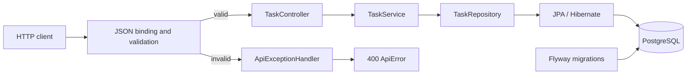

# Phase 3 Spec — PostgreSQL and Spring Data JPA

## Goal

Replace the Task API's in-memory `List<Task>` with persistent PostgreSQL storage using Spring Data JPA and Flyway, while preserving the existing HTTP behavior and validation error contract.

The successful request flow should become:

```text
HTTP request
    -> JSON binding and validation
    -> TaskController
    -> TaskService
    -> TaskRepository
    -> JPA / Hibernate
    -> PostgreSQL
```

The purpose of this phase is not merely to make data survive a restart. It is to understand the basic roles of a relational database, JPA, Hibernate, repositories, migrations, entity lifecycle, and transactions in a Spring application.

## Context

Specs 001 and 002 produced a small Task API with:

- `GET /tasks`;
- `POST /tasks`;
- a `CreateTaskRequest` HTTP request DTO;
- Bean Validation for required titles of at most 100 characters;
- a structured `400 Bad Request` validation response;
- a controller/service boundary; and
- a service-owned `List<Task>` with an application-managed `nextId` value.

The current storage is useful for learning Spring fundamentals, but it has important limitations:

- all tasks disappear whenever the application stops;
- the service owns both application behavior and storage mechanics;
- IDs exist only because the service increments a Java field;
- data cannot be inspected or managed independently of the running application; and
- the storage approach does not provide database constraints or transaction support.

This phase replaces those storage details without redesigning the API. PostgreSQL becomes the durable data store, Flyway owns the database schema, Hibernate maps Java entities to rows, and a Spring Data JPA repository provides the data-access boundary.

## Requirements

### Persistence dependencies

Add the Spring Boot-managed dependencies needed for:

- Spring Data JPA;
- the PostgreSQL JDBC driver;
- Flyway; and
- Flyway's PostgreSQL database support.

Use the appropriate Spring Boot starter rather than assembling Hibernate and Spring Data dependencies individually. Let Spring Boot's dependency management select compatible versions; do not add explicit versions unless there is a verified need.

The existing Spring Web MVC and validation dependencies must remain.

### PostgreSQL database

Use PostgreSQL as the application's only task data store.

- Create or select a local database for this application.
- Configure the application with a JDBC URL, username, and password.
- Keep connection values externalizable through Spring configuration and environment variables.
- Do not commit real or shared credentials.
- Do not add H2 or another substitute database.
- Docker or Docker Compose is not required in this phase; use an already available local PostgreSQL instance.

The exact local database name and credentials may differ by machine. The required Spring properties should make their purpose clear, for example through environment placeholders for the datasource URL, username, and password.

### Flyway migration

Flyway must own schema creation. Add an initial versioned SQL migration under the conventional location:

```text
backend/src/main/resources/db/migration/V1__create_tasks_table.sql
```

The migration must create a `tasks` table with the following columns:

| Column | PostgreSQL type | Rules |
| --- | --- | --- |
| `id` | `BIGINT` identity | Primary key; generated by PostgreSQL |
| `title` | `VARCHAR(100)` | Not null |
| `completed` | `BOOLEAN` | Not null; defaults to `false` |

Use PostgreSQL's identity-column syntax rather than manually managing IDs in Java. The migration should be the source of truth for the physical schema.

Configure Hibernate to validate the mapped schema rather than create or update it. Do not use `spring.jpa.hibernate.ddl-auto=create`, `create-drop`, or `update`. Flyway should apply pending migrations during application startup, and Hibernate should report a mismatch between the entity mapping and migrated schema.

Do not edit an applied migration to evolve a real database. Future schema changes should be introduced through a new migration such as `V2__...`. Only the initial migration is required by this spec.

### JPA entity

Convert the existing `Task` model into the first JPA entity. A separate persistence entity, domain model, response model, and mapper would add unnecessary conversion code while the stored model and public success response still have exactly the same three fields.

The entity must:

- be marked with `@Entity`;
- map explicitly to the `tasks` table;
- mark `id` with `@Id`;
- use database-backed identity generation compatible with the migration;
- map `title` as non-null with a maximum column length of 100;
- map `completed` as non-null;
- have a JPA-compatible no-argument constructor that is not part of the normal public creation API; and
- provide a normal creation path in which the application supplies the title, `completed` starts as `false`, and no ID is supplied by the client or service.

Prefer `Long` for the entity ID so `null` clearly represents an entity that has not yet been persisted. The JSON returned after saving still contains a numeric ID.

Do not revalidate the HTTP title rules in the entity in this phase. `CreateTaskRequest` remains responsible for the existing request validation, while the database's `NOT NULL` and length constraints provide a final persistence-level safeguard.

### ID generation

Remove the service's `nextId` field. PostgreSQL must generate task IDs when rows are inserted.

Use `GenerationType.IDENTITY` to make the beginner-visible relationship between the JPA mapping and the PostgreSQL identity column explicit. After the insert, Hibernate updates the persisted entity with the generated ID, and the API returns that ID.

Database-generated IDs are unique identifiers, not gapless business sequence numbers. Clients must not assume every number will exist, even though IDs should increase during ordinary sequential use of this application.

### Spring Data JPA repository

Introduce one `TaskRepository` interface in the task feature package. It should extend `JpaRepository<Task, Long>` and declare no custom queries.

Spring Data JPA must create the runtime repository implementation. Do not write a repository implementation class, add `@Repository` merely for decoration, or create a project-wide base repository.

The repository is useful now because storage is no longer a Java collection operation. It provides a focused boundary for persistence operations and keeps JPA data access out of the controller.

### Task service

Keep `TaskService` as the application layer between the controller and repository.

Change it so that it:

- receives `TaskRepository` through constructor injection;
- no longer owns a task list;
- no longer generates IDs;
- creates a new unsaved task from a validated title;
- saves it through the repository and returns the saved task; and
- retrieves all tasks through the repository.

`GET /tasks` must preserve the existing creation-order behavior. SQL result order is undefined unless an order is requested, so retrieve tasks ordered by ascending `id`. Use Spring Data's built-in sort support rather than adding a custom query method or `@Query`.

Do not inject the repository into `TaskController`. The controller should continue to depend only on `TaskService`.

### Existing HTTP behavior

Keep both endpoints and their successful response shapes unchanged.

#### `GET /tasks`

- Path: `/tasks`
- Status: `200 OK`
- Returns all persisted tasks ordered by ascending ID.
- Returns `[]` when the table contains no tasks.

Example response:

```json
[
  {
    "id": 1,
    "title": "Learn Spring Data JPA",
    "completed": false
  }
]
```

#### `POST /tasks`

- Path: `/tasks`
- Accepts only the existing create request shape.
- Status for valid input: `201 Created`
- PostgreSQL generates the numeric ID.
- The application sets `completed` to `false`.
- The saved task is returned with the same JSON fields as before.

Example request:

```json
{
  "title": "Learn Spring Data JPA"
}
```

Example response:

```json
{
  "id": 1,
  "title": "Learn Spring Data JPA",
  "completed": false
}
```

Clients must still be unable to control `id` or `completed` through the create request.

### Existing validation and error handling

Preserve Spec 002 behavior:

- `CreateTaskRequest` remains separate from `Task`;
- `@NotBlank` still rejects a missing, null, empty, or whitespace-only title;
- `@Size(max = 100)` still rejects longer titles;
- `@Valid` still triggers validation at the controller boundary;
- validation failures still return the existing `ApiError` shape with `400 Bad Request`; and
- invalid requests must not reach the service or execute a database insert.

The existing validation messages must remain:

- `Title is required`
- `Title must be at most 100 characters`

Do not turn database constraint violations into the normal validation mechanism. Invalid create requests should be rejected before persistence is attempted.

### Persistence lifecycle

The implementation should make the following beginner-level lifecycle visible:

1. `TaskService` constructs a new task. It is a new/transient entity and has no database identity yet.
2. The service passes it to `TaskRepository.save(...)`.
3. JPA asks Hibernate to persist it, Hibernate issues an `INSERT`, and PostgreSQL generates the ID.
4. Hibernate assigns the generated ID to the entity.
5. The saved entity is returned and Spring MVC serializes it as JSON.

The learner should recognize that a JPA entity can be managed by a persistence context during a transaction. Once that context ends, the same Java object may be detached. Detailed entity-state transitions, `merge`, lazy loading, dirty checking across relationships, and persistence-context tuning are not required yet.

### Transactions

Learn the basic rule that a transaction groups database work into one unit that either commits successfully or rolls back on failure.

Do not add explicit service-level `@Transactional` annotations merely because JPA is present. Each current service method performs one repository operation, and Spring Data repository methods already provide the transaction boundary required for that operation:

- `save(...)` performs the single write; and
- `findAll(...)` performs the single read.

An explicit service transaction becomes useful when one application operation must coordinate multiple repository calls or when managed-entity behavior is intentionally required across them. That situation does not exist in this spec.

Do not use `TransactionTemplate`, manual `EntityManager` transaction control, or controller-level transactions.

### Verification

Verify behavior against a real PostgreSQL database. Do not introduce H2 to make tests easier.

Automated persistence testing and Testcontainers are not new learning topics in this phase. The existing context-loading test may be run with a configured PostgreSQL database, but building a new integration-test setup is not required. Manual API and database verification is sufficient for this spec.

## Constraints

- Keep one Spring Boot monolith.
- Use PostgreSQL.
- Use Spring Data JPA with Hibernate as the JPA provider supplied by Spring Boot.
- Use Flyway for schema creation and migration history.
- Keep the existing `GET /tasks` and `POST /tasks` paths, statuses, and JSON contracts.
- Keep all validation and structured error handling from Spec 002.
- Preserve controller -> service -> repository boundaries.
- Do not keep the in-memory task list or Java ID counter as an active fallback.
- Do not let Hibernate generate or update the schema.
- Do not add authentication or authorization.
- Do not add a frontend.
- Do not add Redis or caching.
- Do not introduce microservices, messaging, or background processing.
- Do not add update, delete, or get-by-ID endpoints.
- Do not add pagination, filtering, or user-selected sorting.
- Do not add entity relationships.
- Do not add auditing, optimistic locking, base entities, embedded IDs, or custom ID generators.
- Do not add custom repository queries unless a requirement cannot be met with inherited repository methods; none are expected here.
- Do not add repository or service interfaces with only one implementation.
- Do not add generic base repositories, base services, commands, facades, domain events, or mapper frameworks.
- Do not add explicit transactions where one repository call already supplies the required boundary.
- Do not implement application code as part of writing this specification; the learner will implement it incrementally.

## Learning Objectives

By completing this phase, the learner should understand:

1. **Persistent storage** — how PostgreSQL keeps rows independently of the application process, unlike an in-memory Java list.
2. **Relational schema** — how the `tasks` table, columns, data types, primary key, and constraints represent task data.
3. **JDBC configuration** — how a JDBC URL, database username, password, and PostgreSQL driver allow the application to connect to PostgreSQL.
4. **JPA** — that Jakarta Persistence is a specification/API for mapping Java objects to relational data and managing their persistence; it is not itself the database or concrete implementation.
5. **Hibernate** — that Hibernate is the JPA implementation used by Spring Boot here; it interprets entity mappings and performs SQL/database interaction.
6. **`@Entity`** — how it marks a Java class as persistent and eligible for JPA management.
7. **Table and column mapping** — how an entity and its fields correspond to the `tasks` table and columns.
8. **`@Id`** — why every JPA entity needs an identity and how the primary key connects a Java entity to a database row.
9. **ID generation** — how PostgreSQL identity generation and `GenerationType.IDENTITY` replace the service's `nextId` counter.
10. **JPA constructors** — why JPA needs a no-argument constructor and why normal application code should use a creation path that preserves task defaults.
11. **Spring Data JPA** — how extending `JpaRepository` gives the application common persistence operations and how Spring generates the implementation at runtime.
12. **Repositories** — why a repository boundary becomes useful once storage involves database operations rather than direct list access.
13. **Service boundaries** — why the service coordinates task creation and retrieval while the repository handles persistence and the controller handles HTTP.
14. **Persistence lifecycle** — the beginner-level path from a new entity with no ID to a persisted entity whose database-generated ID is available.
15. **Database ordering** — why row order is not guaranteed without an explicit sort and why ascending ID preserves the current creation-order behavior here.
16. **Migrations** — why database structure should be versioned, repeatable across environments, and changed deliberately rather than being silently generated.
17. **Flyway** — how Flyway discovers versioned migration files, records applied migrations, and applies only pending versions.
18. **Schema validation** — why Hibernate should validate the Flyway-created schema instead of independently changing it.
19. **Transactions** — how a transaction defines commit/rollback boundaries and why transaction scope belongs around a complete application operation.
20. **Proportionate transaction use** — why the current single repository calls do not require additional service annotations, and what future multi-step operation would change that.
21. **Layered safeguards** — how HTTP validation rejects bad client input while database constraints protect persisted data at a different boundary.
22. **Configuration and secrets** — why connection details are environment-specific and real credentials should not be committed to source control.

TypeScript/Node comparison: JPA entities and Hibernate are conceptually similar to using an ORM such as TypeORM or Prisma's persistence layer, although JPA is a Java specification and Hibernate is one implementation. `TaskRepository` plays a role similar to a typed data-access module, while Flyway migrations are versioned SQL changes comparable to migration files in Node database tools. A transaction has the same all-or-nothing purpose regardless of language.

## Expected Architecture

Keep the existing feature-based package. Add only the repository and migration needed for this phase:

```text
backend/
├── pom.xml
└── src/main/
    ├── java/com/example/backend/
    │   ├── BackendApplication.java
    │   ├── error/
    │   │   ├── ApiError.java
    │   │   └── ApiExceptionHandler.java
    │   └── task/
    │       ├── Task.java
    │       ├── CreateTaskRequest.java
    │       ├── TaskRepository.java
    │       ├── TaskService.java
    │       └── TaskController.java
    └── resources/
        ├── application.properties
        └── db/migration/
            └── V1__create_tasks_table.sql
```

Responsibilities:

| Component | Responsibility |
| --- | --- |
| `TaskController` | Handles HTTP mapping, triggers request validation, delegates to the service, and selects success status codes |
| `CreateTaskRequest` | Defines and validates client-controlled create input |
| `TaskService` | Coordinates task creation and ordered retrieval without knowing JDBC or HTTP details |
| `TaskRepository` | Exposes Spring Data JPA persistence operations for `Task` |
| `Task` | Represents both the current task response data and the JPA entity mapped to `tasks` |
| Hibernate | Implements JPA, maps entity operations to SQL, and manages entity persistence |
| Flyway migration | Defines and versions the physical PostgreSQL schema |
| PostgreSQL | Stores task rows durably and generates primary key values |
| `ApiExceptionHandler` / `ApiError` | Preserve the existing validation error contract |



The dependency direction must remain one way: the controller uses the service, and the service uses the repository. PostgreSQL and JPA details must not leak into the controller.

## Functional Acceptance Criteria

The phase is functionally complete when all of the following are verified against PostgreSQL:

1. The application starts successfully with valid PostgreSQL connection settings.
2. Flyway applies `V1__create_tasks_table.sql` to a fresh database.
3. The database contains the `tasks` table and a Flyway schema-history record for the migration.
4. Restarting the application does not recreate the schema or reapply the completed migration.
5. Hibernate validates the migrated schema rather than creating or updating it.
6. `GET /tasks` returns `200 OK` and `[]` when the table is empty.
7. A valid `POST /tasks` returns `201 Created` with a PostgreSQL-generated numeric ID, the submitted title, and `completed: false`.
8. The created task exists as a row in PostgreSQL with matching values.
9. A second valid POST produces a different, greater ID during sequential use.
10. `GET /tasks` returns persisted tasks ordered by ascending ID.
11. After stopping and restarting the Spring Boot application, previously created tasks are still returned.
12. Creating another task after restart uses a new database-generated ID; the service does not reset or manage an ID counter.
13. A title of exactly 100 characters is accepted and persisted.
14. Missing, null, empty, and whitespace-only titles still return `400 Bad Request` with `fieldErrors.title` equal to `Title is required`.
15. A title longer than 100 characters still returns `400 Bad Request` with `fieldErrors.title` equal to `Title must be at most 100 characters`.
16. Every field-validation response preserves numeric `status: 400`, `message: "Validation failed"`, and the `fieldErrors` object.
17. Invalid requests do not insert a row and do not call repository-backed task creation.
18. The controller does not inject or call `TaskRepository` directly.
19. `TaskService` contains no in-memory task collection, `nextId` field, SQL, JDBC code, or HTTP concerns.
20. `TaskRepository` uses inherited Spring Data operations and contains no unnecessary custom query.
21. No real database password or other secret is committed.

## Learning Acceptance Criteria

The phase is complete only when the learner can explain, in their own words:

1. Why tasks now survive an application restart while the previous list did not.
2. The difference between a Java object, a JPA entity, a database row, and a database table.
3. What JPA is and why calling JPA an ORM implementation would be imprecise.
4. What Hibernate does in this application and how it relates to JPA and PostgreSQL.
5. What `@Entity`, `@Table`, `@Id`, `@GeneratedValue`, and the relevant `@Column` mappings communicate.
6. Why `Long id` can represent an unsaved entity more clearly than primitive `long`.
7. Why JPA needs a no-argument constructor and why application code should use a different creation path.
8. The complete path of a valid POST from JSON input to an inserted PostgreSQL row and back to JSON output.
9. When the new task receives its ID and which component actually generates that value.
10. Why the service no longer needs `nextId`, and why database IDs should not be treated as gapless sequence numbers.
11. How Spring creates a usable `TaskRepository` even though the project does not provide an implementation class.
12. Which useful methods come from `JpaRepository` and which ones this API currently needs.
13. Why introducing a repository was unnecessary for the list but is useful for database persistence.
14. Why the controller calls the service rather than calling the repository directly.
15. Why `findAll()` without ordering cannot promise creation order and how built-in sort support solves that without a custom query.
16. The basic transient/new, managed, persisted, and detached ideas without needing advanced lifecycle details.
17. What the JDBC URL, username, password, and PostgreSQL driver each contribute to making a connection.
18. What Flyway does at startup and how it knows whether `V1` has already run.
19. Why changing an already-applied migration is unsafe and why a future schema change should use a new version.
20. Why Flyway creates the schema while Hibernate only validates it in this application.
21. How HTTP validation constraints and PostgreSQL column constraints protect different boundaries.
22. What commit and rollback mean at a basic level.
23. Why an explicit service-level transaction is not needed for the current single-call methods.
24. Give an example of a future operation involving multiple writes that should have one service-level transaction.
25. Why a real PostgreSQL database is more accurate for verification than adding H2 solely for convenience.

The learner should also be able to inspect the `tasks` table and Flyway schema history, identify which layer owns a persistence-related change, and predict whether a failed validation request will execute SQL.

## Suggested Implementation Order

Implement one meaningful step at a time:

1. Prepare a local PostgreSQL database and confirm its URL and credentials independently of Spring.
2. Add the Spring Data JPA, PostgreSQL JDBC, Flyway core, and Flyway PostgreSQL dependencies; understand the role of each before continuing.
3. Configure the datasource through externalizable properties without committing real credentials.
4. Add `V1__create_tasks_table.sql` and configure Hibernate schema validation.
5. Start the application against a fresh database; inspect the `tasks` table and Flyway schema-history table before changing Java storage code.
6. Convert `Task` into a JPA entity with database-generated identity, a JPA-compatible constructor, and an application creation path.
7. Add the minimal `TaskRepository` extending `JpaRepository<Task, Long>` and understand how Spring supplies its implementation.
8. Replace the service's list-based retrieval with repository retrieval ordered by ascending ID. Verify `GET /tasks` returns `[]` for an empty table.
9. Replace the service's Java ID generation and list insertion with creation of a new entity and `repository.save(...)`.
10. Verify a valid POST response and inspect the inserted row and generated ID directly in PostgreSQL.
11. Restart the application and verify that the task remains and that a new task receives a new ID.
12. Re-run every validation case from Spec 002 and confirm invalid requests produce the same errors and no database insert.
13. Review transaction boundaries and confirm that no unnecessary explicit transaction management was added.
14. Review controller/service/repository responsibilities and remove any leftover in-memory storage or leaked persistence concerns.
15. Explain the full persistence flow, migration flow, and entity lifecycle before considering Phase 3 complete.
