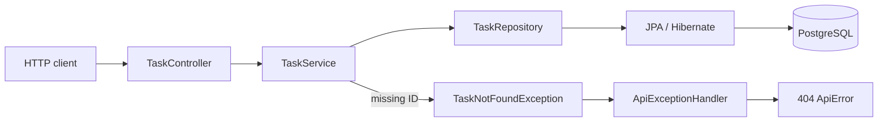

# Phase 4 Spec — Task CRUD and Querying

## Goal

Expand the persisted Task API into practical CRUD-style behavior and add simple filtering and sorting with Spring Data JPA.

The API should support:

- retrieving one task by ID;
- partially updating a task;
- deleting a task;
- returning `404 Not Found` for unknown task IDs; and
- listing tasks with optional completed-status filtering and simple sorting.

The request flow remains:

```text
HTTP request
    -> TaskController
    -> TaskService
    -> TaskRepository
    -> JPA / Hibernate
    -> PostgreSQL
```

The purpose of this phase is to learn how common API operations map to Spring MVC, service-layer decisions, and Spring Data JPA operations. The goal is not to create a generic CRUD framework or a flexible query language.

## Context

Specs 01–03 produced a Task API with:

- `GET /tasks`;
- `POST /tasks`;
- a `Task` JPA entity with `id`, `title`, and `completed`;
- PostgreSQL persistence managed through Spring Data JPA and Hibernate;
- a Flyway-managed `tasks` table;
- Bean Validation for task titles;
- a structured validation error response; and
- a controller -> service -> repository dependency flow.

The API can currently create and list tasks, but a client cannot retrieve one task, correct its title, mark it complete, delete it, or request a focused view of the task list. It also has no application-defined response for an ID that does not exist.

This phase adds those behaviors without changing the database schema. It introduces `Optional`, ID lookup, partial-update semantics, not-found handling, request query parameters, repository derived queries, and Spring Data sorting.

## Requirements

### Existing behavior

Preserve the behavior already established by earlier specs:

- tasks remain stored in PostgreSQL;
- Flyway remains responsible for the schema;
- Hibernate validates rather than creates or updates the schema;
- `POST /tasks` accepts only a title, returns `201 Created`, and creates an incomplete task;
- `GET /tasks` returns `200 OK`;
- task JSON continues to contain `id`, `title`, and `completed`;
- titles must contain at least one non-whitespace character and be at most 100 characters;
- create-request validation errors keep the existing `ApiError` contract; and
- the controller depends on the service, while the service depends on the repository.

No database migration is expected because this spec does not add or change columns.

### `GET /tasks/{id}`

Add an endpoint that retrieves one task by its numeric ID.

Example request:

```http
GET /tasks/12
```

When the task exists:

- return `200 OK`; and
- return the task as JSON.

```json
{
  "id": 12,
  "title": "Learn findById",
  "completed": false
}
```

When the task does not exist, return `404 Not Found` using the not-found behavior defined below.

Use `@PathVariable` to bind the `{id}` path segment to a `Long`. A non-numeric path value is an invalid request and may use Spring MVC's normal `400 Bad Request` handling; custom handling for that binding failure is not required.

The service must use the repository's inherited `findById(...)` operation. It should resolve the returned `Optional<Task>` and either return the task or throw the application's not-found exception. Do not return `Optional` from the controller or serialize it as part of the HTTP response.

### `PATCH /tasks/{id}`

Add an endpoint that partially updates an existing task.

The request may update either or both of these client-controlled fields:

- `title`;
- `completed`.

Use a dedicated request DTO such as `UpdateTaskRequest`. Do not accept the complete `Task` entity as the request body because the client must not update `id`.

Example requests:

```json
{
  "title": "Learn partial updates"
}
```

```json
{
  "completed": true
}
```

```json
{
  "title": "Review Spring Data",
  "completed": false
}
```

When the task exists and the request is valid:

- update only the supplied non-null fields;
- leave every omitted or `null` field unchanged;
- persist the resulting task;
- return `200 OK`; and
- return the updated task as JSON.

For this beginner-focused spec, an omitted field and an explicitly `null` field both mean “do not change this field.” Tracking the distinction between an absent JSON property and an explicit JSON `null` would require additional binding machinery that is not useful yet.

An empty object is therefore a valid no-op update:

```json
{}
```

It returns the current task unchanged with `200 OK`. Although some APIs reject no-op patches, accepting one keeps this phase focused on partial field updates rather than cross-field request rules.

Use `Boolean`, not primitive `boolean`, for `completed` in the update request. `Boolean` can represent three relevant states during binding:

- `true` — set completed;
- `false` — set incomplete; and
- `null` — do not change it.

If the task ID does not exist, return `404 Not Found` and do not create a new task. PATCH is not an upsert in this API.

### Update validation

Preserve the existing title rules whenever a non-null title is supplied in a PATCH request:

- it must contain at least one non-whitespace character; and
- it must contain at most 100 characters.

Invalid examples include:

```json
{ "title": "" }
```

```json
{ "title": "   " }
```

and any non-null title longer than 100 characters.

These requests must return `400 Bad Request` using the existing validation error shape and messages:

- `Title is required` for an empty or whitespace-only supplied title;
- `Title must be at most 100 characters` for an overlong title.

The update DTO's title constraints must be conditional: `null` is allowed because it means “not supplied,” but a non-null value must satisfy the title rules. Use Bean Validation rather than title checks in the controller. A combination of null-tolerant constraints, such as `@Size` plus an appropriate pattern for a non-whitespace character, is sufficient; do not introduce custom validation annotations solely for this request.

Apply `@Valid` to the update request in the controller. Invalid input must be rejected before the service changes the entity.

### `DELETE /tasks/{id}`

Add an endpoint that deletes one existing task by ID.

When the task exists:

- delete it from PostgreSQL;
- return `204 No Content`; and
- return no response body.

When the task does not exist, return `404 Not Found` rather than silently reporting success.

The service should first resolve the task through the same not-found lookup behavior used by GET and PATCH, then delete that entity. This keeps not-found behavior consistent and avoids separate `existsById(...)` and `deleteById(...)` calls for one operation.

After a successful deletion:

- `GET /tasks/{id}` for that ID returns `404 Not Found`; and
- the task no longer appears in `GET /tasks` results.

Deleting a task does not cause PostgreSQL to reuse its ID.

### Not-found handling

Introduce one small application exception such as `TaskNotFoundException`. The service throws it when a requested task ID cannot be resolved.

Extend the existing `ApiExceptionHandler` with a handler that translates this exception to `404 Not Found`. Do not put repeated `try`/`catch` blocks or repository existence checks in controller methods.

Keep the current `ApiError` type rather than adding a second error hierarchy. A not-found response should use:

```json
{
  "status": 404,
  "message": "Task with id 12 was not found",
  "fieldErrors": {}
}
```

Requirements:

- `status` is `404`;
- `message` identifies the missing task ID;
- `fieldErrors` is an empty object because this is not field validation; and
- no stack trace or framework exception details are exposed.

The same behavior must be used by GET, PATCH, and DELETE so each endpoint does not invent its own not-found response.

### Filtering `GET /tasks`

Extend the existing list endpoint with an optional `completed` query parameter.

Examples:

```http
GET /tasks
GET /tasks?completed=true
GET /tasks?completed=false
```

Behavior:

- when `completed` is omitted, return all tasks;
- when `completed=true`, return only completed tasks;
- when `completed=false`, return only incomplete tasks; and
- return `[]` when no task matches.

Use `@RequestParam(required = false)` with `Boolean` so omission can be distinguished from `false`.

Add one simple derived repository method that can combine filtering with sorting:

```text
findByCompleted(boolean completed, Sort sort)
```

Spring Data JPA should derive the query from the method name. A custom JPQL or native SQL query is unnecessary for equality filtering on one mapped property.

### Sorting `GET /tasks`

Support simple sorting through these optional query parameters:

| Parameter | Allowed values | Default |
| --- | --- | --- |
| `sortBy` | `id`, `title`, `completed` | `id` |
| `direction` | `asc`, `desc` | `asc` |

Examples:

```http
GET /tasks?sortBy=title&direction=asc
GET /tasks?completed=false&sortBy=id&direction=desc
```

Sorting must work both with and without the completed filter:

- use inherited `findAll(Sort)` when no filter is supplied; and
- use the derived `findByCompleted(..., Sort)` method when a filter is supplied.

Build a Spring Data `Sort` from the accepted sort field and direction. Explicitly allow only the three public sort fields rather than passing arbitrary client strings directly into persistence behavior.

Unsupported `sortBy` or `direction` values must return `400 Bad Request`. A large query-validation framework or a structured error contract for these simple parameter errors is not required. Spring's normal bad-request handling is acceptable for type/conversion failures; a small deliberate check is acceptable for the sort-field allowlist.

Do not add multiple methods such as `findByCompletedOrderByTitleAsc`, `findByCompletedOrderByTitleDesc`, and equivalent methods for every sort combination. Passing a `Sort` keeps the repository small and avoids a combinatorial set of method names.

### Service-layer responsibility

`TaskService` remains the application boundary for task behavior. It should:

- resolve task IDs and decide when a task is not found;
- apply partial-update rules;
- coordinate persistence for updates and deletes;
- choose between filtered and unfiltered repository operations; and
- construct or apply the permitted Spring Data sort.

`TaskController` should only:

- map HTTP methods and paths;
- bind `@PathVariable`, `@RequestParam`, and request-body values;
- trigger request validation;
- delegate to `TaskService`; and
- select successful HTTP status codes.

`TaskRepository` should only expose persistence operations. It must not contain HTTP decisions, validation responses, or a custom query that Spring Data can derive.

### Transactions and entity updates

PATCH and DELETE each perform a read followed by a state-changing operation. Treat each service method as one unit of work and place its transaction boundary at the service layer.

- the update operation should run in a service-level write transaction;
- the delete operation should run in a service-level write transaction; and
- controller methods must not own transactions.

Within an update transaction, the task returned by `findById(...)` is managed by JPA. Changing its allowed fields can be persisted through Hibernate's dirty checking when the transaction commits. Calling `save(...)` again for that already-managed entity is not required, although the learner should understand why earlier task creation still uses `save(...)` for a new entity.

Do not expand this into advanced persistence-context or isolation-level study. The practical lesson is that one service operation owns the complete lookup-and-change unit of work.

### Verification

Verify the behavior against the existing PostgreSQL database. Automated testing infrastructure is not a new topic in this spec, so focused tests are welcome but not required. Manual API verification must cover successful behavior, validation, filtering, sorting, deletion, persistence, and not-found cases.

## Constraints

- Keep one Spring Boot monolith.
- Keep PostgreSQL as the only task data store.
- Keep Spring Data JPA, Hibernate, and Flyway.
- Keep the existing `Task` entity and `tasks` table; no schema migration is expected.
- Preserve the existing create and validation contracts.
- Preserve controller -> service -> repository boundaries.
- Use inherited repository methods or a simple derived query where appropriate.
- Do not add entity relationships.
- Do not add pagination.
- Do not add authentication or authorization.
- Do not add a frontend.
- Do not add Redis or caching.
- Do not add custom JPQL or native SQL unless an actual requirement cannot be met otherwise; none is expected here.
- Do not add generic CRUD controllers, generic CRUD services, generic base repositories, or reflection-based update utilities.
- Do not add repository or service interfaces with only one implementation.
- Do not add command buses, facades, mapper frameworks, domain events, or a broad exception hierarchy.
- Do not implement PUT, bulk updates, bulk deletes, soft deletes, auditing, optimistic locking, search text, or arbitrary dynamic filtering.
- Do not allow PATCH to change the task ID.
- Do not implement application code as part of writing this specification; the learner will implement it incrementally.

## Learning Objectives

By completing this phase, the learner should understand:

1. **`Optional`** — why `findById(...)` returns a value that explicitly represents “task found” or “task absent” instead of returning `null` without a contract.
2. **Resolving an `Optional`** — how the service can return the contained task or throw a not-found exception, and why `Optional` should not become the endpoint's JSON response.
3. **`findById`** — how the inherited Spring Data repository operation loads one entity by primary key.
4. **`@PathVariable`** — how Spring MVC binds the `{id}` part of `/tasks/{id}` to a Java method parameter.
5. **`404 Not Found`** — why a syntactically valid task URL with an unknown ID is different from invalid input (`400`) or an unexpected server failure (`500`).
6. **Centralized not-found handling** — why the service detects the missing application resource while controller advice translates that outcome into HTTP.
7. **PATCH semantics** — why PATCH describes a partial change instead of replacing the complete resource.
8. **Partial updates** — how nullable update fields distinguish “change to true/false or a string” from “leave unchanged.”
9. **Wrapper versus primitive boolean** — why `Boolean` can represent omission while primitive `boolean` cannot distinguish omission from `false`.
10. **Update DTO boundaries** — why a dedicated request type exposes only fields the client may update and prevents changing `id`.
11. **Conditional validation** — how update validation preserves title rules without requiring a title in every partial request.
12. **Managed entity changes** — how changes to a managed entity are detected and written when a transaction commits.
13. **Service transactions** — why lookup-and-update or lookup-and-delete belongs in one service-layer unit of work.
14. **Delete behavior** — how deletion differs from lookup, why successful deletion returns `204 No Content`, and why an unknown ID returns `404` in this API.
15. **`@RequestParam`** — how optional query-string values are bound separately from path variables and request bodies.
16. **Filtering** — how an optional completed-status parameter changes which rows are requested without changing the endpoint path.
17. **Derived query methods** — how Spring Data interprets `findByCompleted` and creates the query implementation at runtime.
18. **Spring Data sorting** — how `Sort` expresses a property and direction and can be passed to both inherited and derived repository methods.
19. **Safe sort options** — why the API should allow known fields rather than exposing arbitrary persistence property names.
20. **Combining filter and sort** — how the service selects `findAll(sort)` or `findByCompleted(completed, sort)` without duplicating endpoint logic.
21. **When custom queries are unnecessary** — why primary-key lookup, deletion, equality filtering, and property sorting are already covered by repository operations and query derivation.
22. **Layer responsibilities** — why controllers handle HTTP binding, services make application decisions, and repositories perform data access.
23. **Proportionate design** — why explicit task-specific methods are easier to learn and maintain here than generic CRUD abstractions.

TypeScript/Node comparison: `@PathVariable` and `@RequestParam` play roles similar to route parameters and query parameters in Express or Fastify. Java's `Optional<Task>` makes the possible absence from a repository lookup explicit, similar to handling `Task | undefined`, while the service converts that absence into an application error. A PATCH DTO acts like a typed partial input schema, but it deliberately permits only the fields this endpoint owns.

## Expected Architecture

Keep the existing feature-based package and add only the request and exception types needed by this phase:

```text
backend/
└── src/main/java/com/example/backend/
    ├── BackendApplication.java
    ├── error/
    │   ├── ApiError.java
    │   └── ApiExceptionHandler.java
    └── task/
        ├── Task.java
        ├── CreateTaskRequest.java
        ├── UpdateTaskRequest.java
        ├── TaskNotFoundException.java
        ├── TaskRepository.java
        ├── TaskService.java
        └── TaskController.java
```

Responsibilities:

| Component | Responsibility |
| --- | --- |
| `TaskController` | Maps CRUD endpoints, binds IDs/query parameters/bodies, triggers validation, and selects success statuses |
| `CreateTaskRequest` | Preserves validation for task creation |
| `UpdateTaskRequest` | Represents optional title and completed changes and validates a supplied title |
| `TaskService` | Resolves IDs, applies updates, coordinates deletion, and selects filtered/sorted repository operations |
| `TaskRepository` | Provides inherited CRUD operations and one derived completed-status query that accepts `Sort` |
| `Task` | Remains the JPA entity and current successful response model; exposes deliberate state-change methods as needed |
| `TaskNotFoundException` | Represents the application outcome that a requested task ID does not exist |
| `ApiExceptionHandler` | Translates validation and task-not-found exceptions into HTTP error responses |
| PostgreSQL | Persists created, updated, and non-deleted task rows |



The controller must not inject `TaskRepository`. The repository must not make not-found or HTTP decisions. One service helper that resolves an ID or throws `TaskNotFoundException` is appropriate because GET, PATCH, and DELETE need the same behavior; a generic base service is not.

## Functional Acceptance Criteria

The phase is functionally complete when all of the following are verified against PostgreSQL:

1. The application starts successfully without a new schema migration.
2. Existing `POST /tasks` behavior and title validation still work.
3. `GET /tasks/{id}` returns `200 OK` and the correct task when the ID exists.
4. `GET /tasks/{id}` returns the defined `404` response when the ID does not exist.
5. `PATCH /tasks/{id}` with only a valid title changes the title and preserves `completed`.
6. `PATCH /tasks/{id}` with `completed: true` marks the task complete and preserves its title.
7. `PATCH /tasks/{id}` with `completed: false` can change a completed task back to incomplete.
8. `PATCH /tasks/{id}` with both fields changes both fields.
9. `PATCH /tasks/{id}` with `{}` returns `200 OK` and leaves the task unchanged.
10. A `null` PATCH field leaves that field unchanged.
11. PATCH never changes the task ID and does not accept an ID as an update field.
12. A supplied empty or whitespace-only PATCH title returns `400 Bad Request` with the existing required-title message.
13. A supplied title of exactly 100 characters is accepted, while a title longer than 100 characters returns the existing maximum-length error.
14. A failed PATCH validation does not change the persisted task.
15. PATCH for an unknown ID returns the defined `404` response and does not create a task.
16. `DELETE /tasks/{id}` for an existing task returns `204 No Content` with an empty body.
17. A deleted task is absent from PostgreSQL and subsequent GET/list results.
18. DELETE for an unknown or already-deleted ID returns the defined `404` response.
19. GET, PATCH, and DELETE use the same not-found message shape and include the requested ID.
20. `GET /tasks` with no query parameters returns all tasks ordered by `id` ascending.
21. `GET /tasks?completed=true` returns only completed tasks.
22. `GET /tasks?completed=false` returns only incomplete tasks.
23. A completed-status filter with no matches returns `200 OK` and `[]`.
24. Sorting by each allowed field works in ascending and descending directions.
25. Filtering and sorting work together in one request.
26. Unsupported sort fields and directions are rejected with `400 Bad Request` rather than causing a server error.
27. `TaskRepository` uses inherited operations plus a simple derived completed query and contains no custom JPQL/native SQL.
28. `TaskController` does not access `TaskRepository` or contain persistence and not-found logic.
29. `TaskService` owns lookup, partial-update, delete, filter-selection, and sort-selection behavior without depending on HTTP response types.
30. Updated and non-deleted tasks retain their state after an application restart.

## Learning Acceptance Criteria

The phase is complete only when the learner can explain, in their own words:

1. What `Optional<Task>` communicates and why `findById(...)` returns it.
2. How the service turns an empty `Optional` into the API's `404 Not Found` response.
3. Why `Optional` is resolved in the service instead of being returned as endpoint JSON.
4. The role of `@PathVariable` in `GET /tasks/{id}`.
5. Why an unknown numeric ID is a `404`, while an invalid request value is normally a `400`.
6. Why GET, PATCH, and DELETE should share one task-lookup/not-found rule.
7. The difference between PATCH partial-update semantics and full resource replacement.
8. Why omitted or null update fields remain unchanged in this spec.
9. Why the update DTO uses `Boolean` rather than primitive `boolean`.
10. Why `false` must be treated as a real update value rather than as “missing.”
11. Why the update endpoint accepts a request DTO instead of accepting the `Task` entity directly.
12. How title validation can be optional for the request but still reject invalid non-null titles.
13. Why invalid PATCH input cannot partially change the stored entity.
14. What happens from a valid PATCH request through transaction commit and PostgreSQL update.
15. Why a service transaction is useful for lookup-and-change operations and why it does not belong in the controller.
16. Why a managed task can be persisted through dirty checking without a second `save(...)` call.
17. Why successful DELETE returns `204 No Content` and no body.
18. Why this API checks existence for DELETE instead of silently succeeding for unknown IDs.
19. How `@RequestParam` binds `completed`, `sortBy`, and `direction` from the query string.
20. Why `Boolean completed` distinguishes an omitted filter from `completed=false`.
21. How Spring Data derives a query from `findByCompleted` without an implementation class.
22. How a `Sort` object represents the selected property and direction.
23. How one derived filtering method can support several sorting combinations.
24. Why arbitrary sort properties should not be passed directly from an untrusted request.
25. Why `findById`, `findAll(Sort)`, `delete`, and `findByCompleted(..., Sort)` make custom JPQL/native SQL unnecessary here.
26. Which decisions belong to the controller, service, repository, entity, and exception advice.
27. Why a generic CRUD base controller or service would hide useful learning and add unnecessary abstraction at this stage.

The learner should also be able to predict the repository path used for a list request, identify whether a PATCH field changes or remains untouched, and explain the complete successful and not-found flows before moving to the next spec.

## Suggested Implementation Order

Implement one meaningful step at a time:

1. Add `TaskNotFoundException` and one service lookup method that uses `findById(...)` and resolves its `Optional`.
2. Add `GET /tasks/{id}` with `@PathVariable`; verify the existing-task path before adding custom error translation.
3. Add the not-found handler to `ApiExceptionHandler` and verify the required `404 ApiError` for an unknown ID.
4. Create `UpdateTaskRequest` with nullable `title` and `Boolean completed`; add conditional title validation and understand why ordinary create validation cannot be copied unchanged.
5. Add deliberate state-change methods to `Task` for title and completed status.
6. Implement the service-level partial update in a transaction, applying only non-null fields, then expose `PATCH /tasks/{id}`.
7. Verify title-only, true, false, combined, empty, null-field, invalid-title, and unknown-ID PATCH cases.
8. Implement service deletion by resolving the task and deleting it in one service transaction.
9. Add `DELETE /tasks/{id}` with `204 No Content`; verify existing, missing, and repeated deletion behavior.
10. Extend `GET /tasks` with optional `completed`, `sortBy`, and `direction` request parameters while preserving the current defaults.
11. Add `findByCompleted(boolean, Sort)` and route filtered and unfiltered service calls through the appropriate repository method.
12. Add the sort-field allowlist and verify all allowed fields, both directions, filtering plus sorting, and invalid parameter behavior.
13. Restart the application and verify that updates remain persisted and deleted rows remain absent.
14. Review the code for duplicated lookup logic, controller persistence logic, unnecessary queries, repeated sort-specific repository methods, and generic CRUD abstractions.
15. Explain the full lookup, update, delete, filter, sort, transaction, and error flows before considering Phase 4 complete.
