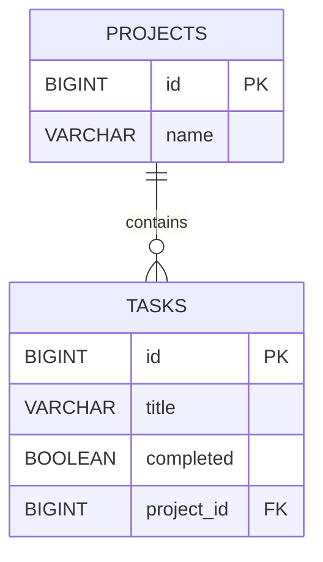

# Spec 005 — Project–Task Relationships

## Goal

Introduce relational data modeling by adding projects and making every task belong to exactly one project.

The application should model this rule in both PostgreSQL and JPA:

- one project can have many tasks;
- each task belongs to one project; and
- a task cannot exist without a valid project.

This spec also introduces response DTOs so the API can describe relationships deliberately without serializing a JPA entity graph directly.

## Context

Specs 001–004 produced a PostgreSQL-backed Task API with:

- task creation, retrieval, partial updates, and deletion;
- completed-status filtering and sorting;
- Bean Validation and structured `400` responses;
- shared `404` handling for unknown task IDs;
- Spring Data JPA repositories and service transactions; and
- Flyway-managed schema changes.

The current `tasks` table is independent: a task has an ID, title, and completion status, but no larger grouping. A project/task application needs to represent that several tasks can belong to the same project while each task has one parent project.

This is the first relationship-focused spec. It should make the database foreign key and the JPA object relationship agree while keeping the public JSON model simple. It is not an exercise in advanced querying, fetch tuning, or generic mapping architecture.

## Requirements

### Project model

Add a `Project` JPA entity with:

| Field | Java type | Database representation | Rules |
| --- | --- | --- | --- |
| `id` | `Long` | `BIGINT` identity | Primary key generated by PostgreSQL |
| `name` | `String` | `VARCHAR(100)` | Required, non-blank API input, at most 100 characters |
| `tasks` | `List<Task>` | No separate column | Inverse side of the one-to-many relationship |

The entity should:

- map explicitly to a `projects` table;
- use the same PostgreSQL identity strategy as `Task`;
- have a JPA-compatible no-argument constructor;
- provide a normal creation path that accepts a name but not an ID; and
- initialize its task collection so it is never `null` in Java.

Project names do not need to be unique in this spec. Do not add descriptions, owners, timestamps, statuses, or other project fields.

### Database relationship and migration

Add a new Flyway migration:

```text
backend/src/main/resources/db/migration/V2__add_projects_and_task_relationship.sql
```

Do not edit the applied `V1__create_tasks_table.sql` migration.

The V2 migration must:

1. create the `projects` table with an identity primary key and required `VARCHAR(100)` name;
2. add a nullable `project_id BIGINT` column to `tasks` temporarily;
3. create a default project named `Default Project`;
4. assign all existing task rows to that project;
5. change `tasks.project_id` to `NOT NULL`;
6. add a foreign-key constraint from `tasks.project_id` to `projects.id`; and
7. add an index on `tasks.project_id`.

The temporary nullable step is migration mechanics, not the final model. It allows existing rows to be backfilled before the `NOT NULL` rule is enforced. After V2 completes, every task row must reference an existing project row.

Use an explicit, descriptive foreign-key constraint name. Do not use `ON DELETE CASCADE`. Project deletion is outside this spec, and silently deleting every task with a project would be an important product decision rather than a default convenience.

The migration may create `Default Project` even when there are no existing tasks. This keeps the migration straightforward and gives task creation an immediately available project during manual verification.

### JPA relationship mapping

Map the relationship in both directions:

- `Task` is the owning side with `@ManyToOne` and `@JoinColumn(name = "project_id")`;
- `Project` is the inverse side with `@OneToMany(mappedBy = "project")`.

The owning side is the side containing the foreign-key mapping. Updating only `Project.tasks` does not change `tasks.project_id`; the `Task.project` reference must be set when creating a task.

Required mapping behavior:

- the task-to-project relationship is mandatory (`optional = false` and a non-null join column);
- map `Task.project` with `fetch = FetchType.LAZY` deliberately;
- keep the project task collection lazy, which is also the JPA default for `@OneToMany`;
- do not add `CascadeType.ALL`, `REMOVE`, or `orphanRemoval`;
- save a newly created task explicitly through `TaskRepository`; and
- deleting a task must never delete its project.

JPA defaults `@ManyToOne` to eager fetching, but this spec should select lazy fetching explicitly so loading a task does not automatically require the complete project entity for every use. This is only an introduction to fetch behavior. Do not add entity graphs, fetch joins, batch fetching, or other fetch optimization yet.

If a relationship helper is added to keep both Java sides synchronized, it must still make clear that `Task.project` is the owning side. A helper and cascade are separate concepts: keeping object references consistent does not cause persistence operations to cascade.

### API DTO boundary

Stop returning `Task` entities directly from controllers. Do not return `Project` entities directly either.

Add small response DTOs with these shapes:

```json
{
  "id": 3,
  "name": "Backend Learning"
}
```

```json
{
  "id": 12,
  "title": "Learn JPA relationships",
  "completed": false,
  "projectId": 3
}
```

`ProjectResponse` contains only `id` and `name`. It must not contain a task collection.

`TaskResponse` contains the existing task fields plus `projectId`. A scalar project ID makes the relationship visible without embedding a complete project or exposing the bidirectional entity graph.

Use direct, small mapping code, such as a constructor or static factory on each response DTO. Do not introduce a mapper framework, generic mapper, or separate mapping layer.

Mapping an entity to a response must happen while any required lazy relationship access is valid. Do not rely on Jackson to traverse lazy JPA associations after the service operation has finished.

### Project creation

Add:

```http
POST /projects
```

The request body is:

```json
{
  "name": "Backend Learning"
}
```

Use a dedicated `CreateProjectRequest` DTO with Bean Validation:

- missing, null, empty, or whitespace-only names are invalid;
- names longer than 100 characters are invalid; and
- clients cannot supply an ID or task collection.

Use these messages:

- `Project name is required`
- `Project name must be at most 100 characters`

A valid request returns `201 Created` and a `ProjectResponse`. Validation failures use the existing `ApiError` shape and return `400 Bad Request` before persistence.

### Project retrieval

Add:

```http
GET /projects
GET /projects/{id}
```

`GET /projects` returns `200 OK` and all projects ordered by ascending ID. It returns `[]` when there are none. Each item is a shallow `ProjectResponse`; this endpoint does not embed tasks.

`GET /projects/{id}` returns `200 OK` with a `ProjectResponse` when found. For an unknown ID, the service throws a small `ProjectNotFoundException`, and the existing exception advice returns:

```json
{
  "status": 404,
  "message": "Project with id 99 was not found",
  "fieldErrors": {}
}
```

Do not return `Optional`, a JPA proxy, or the project entity from the controller.

### Task creation under a project

Replace the old task-creation route with:

```http
POST /projects/{projectId}/tasks
```

The request body remains title-only:

```json
{
  "title": "Learn owning sides"
}
```

The project comes from the path, not from a second `projectId` body field. Continue using `CreateTaskRequest` and its existing title validation.

For a valid project and title, the operation must:

1. load the project or produce the standard project `404` response;
2. create an incomplete task associated with that project;
3. persist the task through `TaskRepository`; and
4. return `201 Created` with a `TaskResponse` containing the selected `projectId`.

This lookup-and-create operation must run in one service-level transaction because it coordinates project lookup and task persistence as one application operation.

If the project does not exist, return `404 Not Found` and do not insert a task. Invalid title input still returns the existing `400` validation response and must not reach persistence.

`POST /tasks` is no longer the task-creation endpoint because it cannot identify the required parent project. Do not support both creation contracts merely for backward compatibility.

### Existing task behavior

Preserve these existing endpoints and behaviors:

- `GET /tasks` with optional `completed`, `sortBy`, and `direction` parameters;
- `GET /tasks/{id}`;
- `PATCH /tasks/{id}` for `title` and `completed` only; and
- `DELETE /tasks/{id}`.

Their successful task response bodies now use `TaskResponse` and therefore add `projectId`. Existing task IDs, titles, completion values, validation, filtering, sorting, transaction behavior, deletion behavior, and task `404` responses remain unchanged.

PATCH must not move a task to another project. Changing project membership is outside this spec. The allowed sort fields remain `id`, `title`, and `completed`; do not add relationship sorting.

No project-specific task-list endpoint is required yet. `GET /tasks` remains the one list endpoint, and its results reveal membership through `projectId`.

### Services and repositories

Add one `ProjectRepository extends JpaRepository<Project, Long>`. Use inherited repository operations for project creation, lookup, and sorted listing.

Add one concrete `ProjectService` for project operations. Do not add a service interface with one implementation.

Keep relationship creation in `TaskService`, because creating and persisting a task remains task behavior. `TaskService` may depend on both `TaskRepository` and `ProjectRepository` so it can resolve the parent and save the child. Do not make one repository call another repository.

`ProjectController` owns `/projects` HTTP mappings. It may delegate project CRUD-style operations to `ProjectService` and nested task creation to `TaskService`. Controllers must not access repositories or JPA relationships directly.

Services should return response DTOs to the controllers. Use appropriately scoped service transactions when mapping requires managed lazy relationships; read-only transactions are suitable for read operations. Do not place transactions on controllers.

### Cascade and lifecycle behavior

Use no JPA cascade options in this phase.

The intended behavior is explicit:

- saving a project saves only that project;
- saving a new task saves that task and its foreign-key reference to an already-persisted project;
- updating a task does not update the project;
- deleting a task does not delete the project; and
- project deletion is not exposed.

Cascade configuration controls whether an entity operation is propagated through an object relationship. It is not required merely because two entities are related, and JPA cascade behavior is distinct from a PostgreSQL `ON DELETE` action.

### Verification

Verify the migration and API against PostgreSQL. Focused automated tests are welcome, but introducing Testcontainers or a new integration-test architecture is not part of this spec. Manual verification must include inspecting the tables, foreign key, backfilled rows, API DTO shapes, validation, and not-found behavior.

## Constraints

- Keep one Spring Boot monolith.
- Keep PostgreSQL, Spring Data JPA, Hibernate, and Flyway.
- Use a proper non-null PostgreSQL foreign key for task ownership.
- Use `@ManyToOne` and `@OneToMany(mappedBy = ...)` appropriately.
- Keep the model to projects and tasks; do not add more entities.
- Do not add many-to-many relationships.
- Do not add project deletion or task reassignment.
- Do not expose JPA entities or bidirectional relationship collections as API responses.
- Do not use Jackson annotations as the primary solution to entity-graph recursion; use response DTOs.
- Do not add advanced fetch optimization, entity graphs, custom fetch joins, or batch tuning.
- Do not add pagination.
- Do not add authentication or authorization.
- Do not add a frontend.
- Do not add Redis, caching, messaging, background processing, or microservices.
- Do not add repository/service interfaces with one implementation, generic CRUD abstractions, mapper frameworks, or base entities.
- Do not add custom JPQL or native queries; inherited and existing derived repository operations are sufficient.
- Do not change project membership through PATCH.
- Do not implement application code as part of writing this specification; the learner will implement it incrementally.

## Learning Objectives

By completing this spec, the learner should understand:

1. **Relational data modeling** — how projects and tasks become separate tables connected by a key rather than duplicated project data in every task.
2. **Cardinality** — what “one project has many tasks” and “each task has one project” mean in this application.
3. **Primary and foreign keys** — how `projects.id` identifies a project and `tasks.project_id` references it.
4. **Referential integrity** — how PostgreSQL prevents a task from referencing a project row that does not exist.
5. **Mandatory relationships** — how `NOT NULL`, the foreign key, `optional = false`, and application behavior express related but different safeguards.
6. **Relationship migrations** — why existing rows must be backfilled before a new foreign-key column can become non-null.
7. **Migration immutability** — why V1 remains unchanged and the relationship is introduced through V2.
8. **`@ManyToOne`** — why the task holds one `Project` reference even though the table stores a scalar `project_id`.
9. **`@JoinColumn`** — how JPA is told which task-table column stores the relationship.
10. **`@OneToMany`** — how the project represents its collection of tasks in Java without adding a collection-valued database column.
11. **Owning side** — why `Task.project` controls the foreign key and must be set when creating a task.
12. **Inverse side and `mappedBy`** — how `mappedBy = "project"` tells JPA that `Project.tasks` mirrors the relationship already mapped by `Task.project` rather than defining a second join.
13. **Bidirectional consistency** — why both Java references may be synchronized in memory even though only the owning side writes the foreign key.
14. **Basic fetch behavior** — that `@OneToMany` is lazy by default, `@ManyToOne` is eager by default, and this application deliberately maps the latter as lazy.
15. **Lazy relationship boundaries** — why application code should map required values within a suitable service transaction rather than letting JSON serialization explore entities later.
16. **Cascade behavior** — what persistence cascading does, why relationships do not automatically require it, and why no cascade is safest for the operations currently supported.
17. **JPA cascade versus database cascade** — why `CascadeType.REMOVE` and `ON DELETE CASCADE` operate at different layers and neither is wanted here.
18. **Entity relationships versus API DTOs** — why a useful persistence model does not have to be the public JSON model.
19. **Recursive graph problems** — how directly serializing `Project.tasks[*].project.tasks...` can recurse, produce oversized responses, or trigger unexpected lazy loads.
20. **Purposeful response design** — why `ProjectResponse` stays shallow and `TaskResponse.projectId` communicates membership without exposing the complete graph.
21. **Nested resource creation** — why `/projects/{projectId}/tasks` clearly identifies the parent required to create a task.
22. **Transaction scope** — why resolving a project and creating its task belong to one service operation.
23. **Layer responsibilities** — how controllers bind HTTP input, services coordinate relationship behavior, repositories persist entities, and the database enforces integrity.
24. **Indexes on foreign keys** — why an index on `tasks.project_id` supports future lookups by project even though PostgreSQL does not automatically create that index for a foreign key.

TypeScript/Node comparison: the foreign key is the same relational rule used by SQL tools in a Node application. `@ManyToOne` and `@OneToMany` provide an ORM object view similar to relations in TypeORM or Prisma, while `TaskResponse` and `ProjectResponse` play the role of explicit API output types. As in TypeScript, returning ORM objects directly can accidentally couple API JSON to persistence details.

## Expected Architecture and Data Model

Keep feature-based packages:

```text
backend/src/main/
├── java/com/example/backend/
│   ├── error/
│   │   ├── ApiError.java
│   │   └── ApiExceptionHandler.java
│   ├── project/
│   │   ├── Project.java
│   │   ├── CreateProjectRequest.java
│   │   ├── ProjectResponse.java
│   │   ├── ProjectNotFoundException.java
│   │   ├── ProjectRepository.java
│   │   ├── ProjectService.java
│   │   └── ProjectController.java
│   └── task/
│       ├── Task.java
│       ├── CreateTaskRequest.java
│       ├── UpdateTaskRequest.java
│       ├── TaskResponse.java
│       ├── TaskNotFoundException.java
│       ├── TaskRepository.java
│       ├── TaskService.java
│       └── TaskController.java
└── resources/db/migration/
    ├── V1__create_tasks_table.sql
    └── V2__add_projects_and_task_relationship.sql
```

Responsibilities:

| Component | Responsibility |
| --- | --- |
| `ProjectController` | Maps project create/read endpoints and nested task creation, validates input, and selects success statuses |
| `ProjectService` | Creates projects, resolves project IDs for project reads, and lists projects |
| `ProjectRepository` | Provides inherited project persistence operations |
| `Project` | Maps the project row and inverse task collection |
| `TaskController` | Preserves task list/read/update/delete HTTP behavior |
| `TaskService` | Coordinates task behavior, including project lookup and task creation on the owning side |
| `TaskRepository` | Provides existing task persistence, filtering, and sorting operations |
| Response DTOs | Define stable, non-recursive JSON without exposing persistence entities |
| `ApiExceptionHandler` | Translates request validation and project/task not-found outcomes into existing error JSON |
| Flyway V2 | Creates projects, backfills existing tasks, and enforces the foreign key |
| PostgreSQL | Enforces primary keys, required columns, and referential integrity |



The database stores the relationship on `tasks.project_id`. JPA represents the same relationship as `Task.project` plus the inverse `Project.tasks` collection. The API represents it more narrowly as `TaskResponse.projectId`.

## Functional Acceptance Criteria

The spec is functionally complete when all of the following are verified:

1. Flyway applies V2 after the unchanged V1 migration.
2. PostgreSQL contains `projects` with `id` and required `name` columns.
3. PostgreSQL contains a non-null `tasks.project_id` column with a foreign key to `projects.id` and an index.
4. V2 creates `Default Project` and assigns every task that existed before V2 to it.
5. No task row remains with a null or nonexistent project reference.
6. Hibernate validates the migrated schema successfully rather than creating or updating it.
7. `POST /projects` with a valid name returns `201` and an ID/name response.
8. Invalid blank or overlong project names return `400` with the required messages and create no row.
9. `GET /projects` returns all projects ordered by ascending ID as shallow responses.
10. `GET /projects/{id}` returns the matching shallow response.
11. Reading an unknown project returns the defined `404 ApiError`.
12. `POST /projects/{projectId}/tasks` with valid input returns `201`, `completed: false`, and the path's `projectId`.
13. The created task row contains the correct foreign key in PostgreSQL.
14. Creating a task under an unknown project returns the project `404` and inserts no task.
15. Existing task title validation still rejects invalid nested task-creation requests before persistence.
16. `POST /tasks` is not retained as an alternative creation contract.
17. Existing task list, single read, PATCH, DELETE, filtering, sorting, validation, and task-not-found behavior still work.
18. Every successful task response contains `id`, `title`, `completed`, and `projectId` without embedding a project or tasks collection.
19. Every project response contains only `id` and `name` without embedding tasks.
20. PATCH changes only title/completed and cannot change project membership.
21. Deleting a task leaves its project intact.
22. Saving a project does not implicitly save unsaved tasks through cascade.
23. API responses do not recurse, expose Hibernate proxy details, or fail because Jackson traverses a lazy relationship graph.
24. Controllers do not access repositories, and repositories contain no HTTP or DTO concerns.
25. No custom query, mapper framework, advanced fetch mechanism, or unnecessary generic abstraction is introduced.

## Learning Acceptance Criteria

The spec is complete only when the learner can explain, in their own words:

1. Why project and task data belong in separate tables.
2. What the one-to-many and many-to-one descriptions mean using concrete project/task examples.
3. Which columns are the primary key and foreign key, and what invalid data the foreign key prevents.
4. Why `tasks.project_id` is non-null in the final schema.
5. Why V2 first adds the column as nullable, backfills rows, and only then makes it non-null.
6. Why V1 must not be edited after it has been applied.
7. How the V2 migration behaves for tasks created before relationships existed.
8. What `@ManyToOne`, `@JoinColumn`, `@OneToMany`, and `mappedBy` each communicate to JPA.
9. Why `Task` is the owning side even though people may describe a project as “having” its tasks.
10. What would happen if only the inverse `Project.tasks` collection were changed.
11. Why a relationship helper may update both Java sides and why that does not make both sides owners.
12. The default fetch behavior of `@ManyToOne` and `@OneToMany`, and the deliberate fetch choice in this spec.
13. What lazy loading means at a beginner level and why transaction boundaries matter when accessing relationships.
14. Why this phase does not attempt to solve N+1 queries or add fetch optimization yet.
15. What cascade means and why no cascade option is needed for creating a task under an existing project.
16. Why deleting a task must not delete its project.
17. The difference between JPA cascade operations and a database `ON DELETE CASCADE` rule.
18. Why entities are no longer returned directly from controllers.
19. How a bidirectional entity graph can cause recursive or unexpectedly large JSON.
20. Why `projectId` is enough in `TaskResponse` for the current API and why `ProjectResponse` omits tasks.
21. The complete flow from `POST /projects/{projectId}/tasks` through validation, project lookup, entity creation, SQL insert, and response mapping.
22. Why project lookup and task insertion should share one service transaction.
23. Why an unknown project creates no task and becomes a `404` rather than a foreign-key error exposed to the client.
24. Which existing task behaviors were preserved and which task-creation contract necessarily changed.
25. Why indexing a foreign-key column is useful for future project-based task queries.

The learner should also be able to draw the two-table relationship, identify the owning and inverse sides in code, inspect the constraint in PostgreSQL, and predict the JSON returned by each endpoint before moving to the next spec.

## Suggested Implementation Order

Implement one meaningful step at a time:

1. Draw the `projects` and `tasks` tables, identify the keys/cardinality, and explain why the foreign key belongs on `tasks`.
2. Write V2 to create `projects`, add the temporary nullable column, create `Default Project`, backfill existing tasks, enforce `NOT NULL`, add the foreign key, and add the index.
3. Run the migration against the existing database and inspect the project row, task foreign keys, constraint, index, and Flyway history.
4. Add the minimal `Project` entity and `ProjectRepository` without adding the task collection yet; verify Hibernate still identifies any mapping/schema mismatch.
5. Add `Task.project` with mandatory `@ManyToOne`/`@JoinColumn` mapping and understand why it is the owning side.
6. Add `Project.tasks` with `@OneToMany(mappedBy = "project")`; explain the inverse side before adding any helper method.
7. Add `CreateProjectRequest`, `ProjectResponse`, project creation, and its validation; verify `POST /projects`.
8. Add project listing and single-project lookup, including project `404` handling; verify responses do not contain tasks.
9. Add `TaskResponse` and convert existing task endpoints from entity responses while preserving their behavior.
10. Move task creation to `POST /projects/{projectId}/tasks`; in one service transaction resolve the project, set the owning side, save the task, and map the response.
11. Verify valid creation, unknown-project creation, title validation, and the stored foreign-key value.
12. Re-run all existing task read, filter, sort, PATCH, DELETE, validation, and not-found checks using the new response shape.
13. Verify that task deletion leaves the project intact and that no unintended persistence cascade is configured.
14. Review for entity exposure, recursive JSON risk, lazy access outside service transactions, repository access in controllers, and unnecessary abstractions.
15. Explain the migration, database relationship, JPA ownership, fetch behavior, cascade choice, transaction, and DTO boundary before considering Spec 005 complete.
