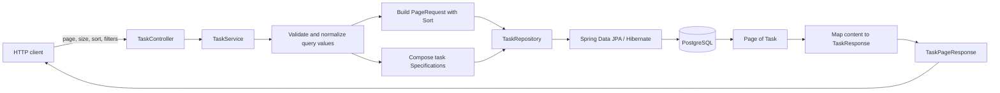

# Spec 006 — Pagination and Richer Task Querying

## Goal

Improve `GET /tasks` so clients can request one manageable page of tasks and combine practical query options using Spring Data JPA.

The endpoint should support:

- zero-based page number and page size;
- the existing sorting options;
- optional filtering by completion status;
- optional filtering by project;
- optional case-insensitive title search;
- combinations of those filters; and
- a deliberate JSON response containing task data and pagination metadata.

The request flow remains:

```text
HTTP request with optional query parameters
    -> TaskController
    -> TaskService
    -> TaskRepository
    -> Spring Data JPA / Hibernate
    -> PostgreSQL
```

The purpose of this spec is to learn how pagination and composable queries work across Spring MVC, Spring Data, and the API response boundary. It is not an exercise in building a generic search language or optimizing very large databases.

## Context

Specs 001–005 produced a PostgreSQL-backed project/task API with:

- task creation under a project;
- task retrieval, partial update, and deletion;
- optional completed-status filtering;
- sorting by `id`, `title`, or `completed`;
- project/task relationships and response DTOs;
- service-layer transaction boundaries; and
- controller -> service -> repository dependency flow.

`GET /tasks` currently returns a complete `List<TaskResponse>`. This is understandable for a small data set, but its cost and response size grow with the number of tasks. A client also cannot currently limit results to one project or search titles.

Adding several optional filters creates a second design issue. A derived method such as `findByCompleted(...)` is clear for one fixed condition, but separate methods for every combination of completed status, project, title, and sorting would grow quickly. This spec therefore introduces Spring Data `Specification<Task>` as a small, justified composition tool after the learner understands why fixed derived methods stop scaling well. It must remain task-specific and simple.

No schema migration is expected. The existing index on `tasks.project_id` remains useful for project filtering, but index design and query tuning are outside this spec.

## Requirements

### Preserve existing behavior

Preserve all behavior established by earlier specs except for the intentional response change to `GET /tasks`:

- PostgreSQL remains the data store;
- Flyway remains responsible for schema changes;
- Hibernate continues to validate the schema;
- `POST /projects/{projectId}/tasks` continues to create an incomplete task under an existing project;
- `GET /tasks/{id}`, `PATCH /tasks/{id}`, and `DELETE /tasks/{id}` retain their paths, statuses, validation, and not-found behavior;
- task responses continue to contain `id`, `title`, `completed`, and `projectId`;
- project endpoints remain unchanged; and
- controllers depend on services, while services depend on repositories.

`GET /tasks` continues to return `200 OK`, but it now returns a paginated object instead of a top-level JSON array. This is an intentional API contract change.

### `GET /tasks` query parameters

Support these optional query parameters:

| Parameter | Meaning | Default / behavior |
| --- | --- | --- |
| `page` | Zero-based page number | `0` |
| `size` | Maximum tasks requested in one page | `20` |
| `sortBy` | Task field used for sorting | `id` |
| `direction` | Sort direction | `asc` |
| `completed` | Exact completion-status filter | No completion filter |
| `projectId` | Exact project ID filter | No project filter |
| `title` | Case-insensitive title substring | No title filter |

Examples:

```http
GET /tasks
GET /tasks?page=0&size=10
GET /tasks?page=1&size=5&sortBy=title&direction=desc
GET /tasks?completed=false&page=0&size=20
GET /tasks?projectId=3
GET /tasks?title=spring
GET /tasks?projectId=3&completed=false&title=jpa&sortBy=title&direction=asc&page=0&size=10
```

All query parameters belong to the same list endpoint. Do not create separate endpoints for completed tasks, project tasks, or title search in this spec.

### Page number and page size

Use zero-based page numbers because that is the model used by Spring Data's `PageRequest`:

- `page=0` requests the first page;
- `page=1` requests the second page; and
- the offset is conceptually `page * size`, although application code should let Spring Data calculate it.

Page-size rules:

- the default size is `20`;
- the minimum accepted size is `1`; and
- the maximum accepted size is `100`.

Reject a negative page number, a size below `1`, or a size above `100` with `400 Bad Request`. Use the existing `ApiError` shape. A small explicit validation check is sufficient; do not create a reusable query-validation framework.

A requested page beyond the available results is not an error. Return `200 OK` with empty `content` and accurate totals for the complete filtered result set.

### Sorting with pagination

Keep the existing public sorting contract:

| Parameter | Allowed values | Default |
| --- | --- | --- |
| `sortBy` | `id`, `title`, `completed` | `id` |
| `direction` | `asc`, `desc` | `asc` |

Unsupported values still return `400 Bad Request`. Do not pass arbitrary client-provided property names directly to Spring Data.

Construct a Spring Data `Sort`, then include it in the `PageRequest`. The `Pageable` sent to the repository must therefore describe page number, page size, and ordering together.

Pagination needs stable ordering. When sorting by `title` or `completed`, multiple tasks may have the same value. Add ascending `id` as a secondary sort so repeated requests have a deterministic tie-breaker. Sorting by `id` itself needs no duplicate `id` sort.

Examples of the intended ordering:

```text
sortBy=id&direction=desc
    -> id DESC

sortBy=title&direction=asc
    -> title ASC, id ASC

sortBy=completed&direction=desc
    -> completed DESC, id ASC
```

The secondary ID direction remains ascending because it is only a stable tie-breaker, not a second client-controlled sort option.

### Completed-status filter

Continue supporting:

```http
GET /tasks?completed=true
GET /tasks?completed=false
```

Use nullable `Boolean` request data so omission remains distinct from `false`:

- omitted: do not add a completion predicate;
- `true`: include only completed tasks;
- `false`: include only incomplete tasks.

The filter applies before pagination. Pagination metadata must describe the filtered result set, not all tasks in the table.

### Project filter

Support exact project filtering through `projectId`:

```http
GET /tasks?projectId=3
```

When supplied, every returned task must have that `projectId`. A positive project ID that does not exist produces an empty page, not `404 Not Found`. This endpoint is querying a collection; “no matching rows” is a successful empty search rather than a request for one required project resource.

Reject `projectId` values below `1` with `400 Bad Request`. Do not perform a separate project-existence lookup merely to filter tasks. The task query should use the mapped `Task.project.id` relationship and let no matches produce an empty result.

Do not add `GET /projects/{projectId}/tasks` in this spec. Nested task creation remains unchanged, while task querying remains on `GET /tasks`.

### Simple title search

Support a case-insensitive substring search through `title`:

```http
GET /tasks?title=spring
```

It should match titles such as:

- `Learn Spring Data`;
- `SPRING pagination`; and
- `Review spring MVC`.

The search is not an exact match and is not case-sensitive. Trim leading and trailing whitespace from the supplied search term. If the resulting value is empty, treat the title filter as omitted rather than querying for every row with an empty substring.

This is deliberately a basic database string search. Do not add full-text search, relevance scoring, fuzzy matching, tokenization, external search services, or native database-specific search syntax.

### Combining filters

The three filters must work independently and in combination:

- completed only;
- project only;
- title only;
- completed + project;
- completed + title;
- project + title; and
- completed + project + title.

Every active filter uses AND semantics. For example:

```http
GET /tasks?projectId=3&completed=false&title=jpa
```

means:

```text
task belongs to project 3
AND task is incomplete
AND task title contains "jpa" ignoring case
```

Sorting applies to the matching rows, and pagination is applied after filtering and sorting.

### Query composition approach

Use Spring Data JPA Specifications for the final combined query design:

- `TaskRepository` should continue to extend `JpaRepository<Task, Long>`;
- it should additionally extend `JpaSpecificationExecutor<Task>`;
- each supplied filter contributes one task-specific `Specification<Task>` predicate;
- omitted filters contribute no restrictive predicate; and
- the composed specification is executed with one `Pageable`.

The resulting repository call should conceptually be:

```text
findAll(composedTaskSpecification, pageable)
```

Keep composition understandable. Small task-specific specification helper methods are acceptable, either kept near the task query code or placed in one `TaskSpecifications` class if that makes the predicates easier to read. Do not introduce a generic filter object model, reflection, string-based operators, a query language, or reusable cross-entity specification framework.

Repository derived queries remain an important learning topic. The learner should understand that fixed methods such as `findByCompleted(boolean, Pageable)` or `findByProjectId(Long, Pageable)` are useful when a query has one stable shape. They become impractical here because every optional combination would require increasingly long names or many branching methods, for example a completed + project + title method plus methods for every smaller combination. Specifications are justified by this concrete combinatorial problem, not because every repository query should use them.

Do not add custom JPQL or native SQL. The required predicates can be expressed with mapped entity properties and Spring Data Specifications.

### `Pageable`, `PageRequest`, and `Page<T>`

The implementation should make the roles of these Spring Data types explicit:

- `Pageable` is the abstraction describing which page, how many items, and what sort order to request;
- `PageRequest` is the concrete value created from the validated request parameters; and
- `Page<Task>` is the repository result containing the current task slice plus totals and page information.

The controller may bind the individual API parameters explicitly and delegate them to the service. Do not expose every Spring Data pagination convention automatically through a controller `Pageable` parameter in this spec. Explicit parameters keep the public API defaults, maximum size, sort allowlist, and learning flow visible.

The service should create the `PageRequest`, compose the task filters, execute the repository query, and map the result. Use `Page.map(...)` or an equivalently clear approach so task entities become `TaskResponse` DTOs while preserving page metadata.

### Paginated response shape

Do not return Spring Data's `Page` implementation directly from the controller. Define one small, explicit task-page response DTO so the API contract does not depend on framework serialization details.

`GET /tasks` must return this shape:

```json
{
  "content": [
    {
      "id": 12,
      "title": "Learn Pageable",
      "completed": false,
      "projectId": 3
    }
  ],
  "page": 0,
  "size": 20,
  "numberOfElements": 1,
  "totalElements": 1,
  "totalPages": 1,
  "first": true,
  "last": true
}
```

Metadata meanings:

| Field | Meaning |
| --- | --- |
| `content` | Tasks in the requested page after filtering and sorting |
| `page` | Current zero-based page number |
| `size` | Requested page size |
| `numberOfElements` | Number of tasks actually present in this page |
| `totalElements` | Total number of tasks matching all filters |
| `totalPages` | Number of pages required at the requested size |
| `first` | Whether this is the first page according to the Spring Data result |
| `last` | Whether there is no later page according to the Spring Data result |

For an empty complete result set, `content` is `[]`, `numberOfElements` and `totalElements` are `0`, and `totalPages` is `0`. Populate metadata from `Page` rather than recalculating totals in the controller.

Spring Data commonly executes both a content query and a count query to produce `Page<T>` metadata. The learner should understand why totals are useful and that they are not free, but count-query optimization is outside this spec.

### Layer responsibilities

`TaskController` should:

- map `GET /tasks`;
- bind optional query parameters and defaults;
- delegate the query operation to `TaskService`; and
- return the task-page response.

It must not create JPA predicates, call repositories, map entities, or calculate pagination metadata.

`TaskService` should:

- validate the small set of pagination and allowed-sort rules;
- normalize the optional title search;
- create `Sort` and `PageRequest` values;
- compose task-specific specifications from supplied filters;
- execute the repository query;
- map `Task` values to `TaskResponse`; and
- return the explicit paginated response DTO.

`TaskRepository` should:

- expose inherited CRUD behavior;
- support specification execution through `JpaSpecificationExecutor`; and
- contain no HTTP defaults, response DTO construction, or manual pagination calculations.

The existing concrete service and repository interfaces are sufficient. Do not add a service interface, query bus, facade, or generic pagination service.

### Transactions and DTO mapping

Keep the task list operation read-only at the service layer. The result still maps `Task.project.id` into `TaskResponse`, so mapping should occur within the read-only service transaction where the lazy project reference is safe to access.

Do not move transaction annotations to the controller and do not return entities for Jackson to traverse after the service operation.

### Verification

Verify the behavior against PostgreSQL. Focused automated tests are welcome, but introducing a new testing architecture is not part of this spec. Manual verification must cover defaults, page boundaries, invalid pagination, each filter, combined filters, sorting, metadata, and preservation of existing CRUD behavior.

Use enough task rows across at least two projects, with repeated completion values and similar titles, to make page boundaries and combined filters observable.

## Constraints

- Keep one Spring Boot monolith.
- Keep PostgreSQL, Spring Data JPA, Hibernate, and Flyway.
- Preserve the existing Project and Task entities and their relationship.
- Preserve all create, single-read, update, delete, validation, and not-found behavior.
- Preserve controller -> service -> repository boundaries.
- Use `Pageable`, `PageRequest`, `Page<T>`, and Spring Data sorting.
- Use task-specific Specifications only because several optional filters now need composition.
- Keep query parameters explicit and understandable.
- No database migration is expected.
- Do not add authentication or authorization.
- Do not add a frontend.
- Do not add Redis or caching.
- Do not add full-text search or an external search engine.
- Do not add advanced database optimization, special indexes, query hints, entity graphs, or fetch tuning.
- Do not add native SQL; custom JPQL is also unnecessary for these requirements.
- Do not add Querydsl or another query dependency.
- Do not build a generic filtering, sorting, specification, or pagination framework.
- Do not support arbitrary fields, operators, multi-column client sort syntax, cursor pagination, or keyset pagination.
- Do not add separate task-list routes for each filter.
- Do not add a project-existence query solely for collection filtering.
- Do not return JPA entities or a framework `Page` implementation directly from the controller.
- Do not add repository/service interfaces with one implementation, mapper frameworks, command buses, or facades.
- Do not implement application code as part of writing this specification; the learner will implement it incrementally.

## Learning Objectives

By completing this spec, the learner should understand:

1. **Why pagination exists** — how returning every matching row increases database work, memory use, serialization work, network payload size, and client processing as data grows.
2. **Pagination versus a full list** — why a page deliberately returns only part of a result set and requires metadata to help clients navigate it.
3. **Page number and page size** — how zero-based page numbers identify a result window and how page size limits the requested content.
4. **`Pageable`** — how Spring Data represents page, size, and sorting as one repository input contract.
5. **`PageRequest`** — how validated API values become a concrete `Pageable` instance.
6. **`Page<T>`** — how a repository result carries content plus total and positional metadata.
7. **`Page` versus `List`** — why a `List` contains only items while a `Page` also describes the larger matching result set.
8. **Pagination metadata** — what current page, requested size, current element count, total elements, total pages, first, and last each communicate.
9. **Count queries** — why obtaining `totalElements` and `totalPages` generally requires more database work than returning content alone.
10. **API pagination design** — why this API uses a stable response DTO instead of exposing framework-specific `Page` serialization.
11. **Zero-based API tradeoff** — why matching Spring Data's numbering keeps translation simple, even though some user-facing interfaces display page numbers starting at one.
12. **Page-size limits** — why a maximum protects the purpose of pagination instead of allowing clients to request an effectively unlimited list.
13. **Out-of-range pages** — why an empty page is a successful collection query rather than a missing individual resource.
14. **Sorting with `Pageable`** — how the sort becomes part of `PageRequest` and is applied before the database selects the requested page.
15. **Stable ordering** — why non-unique sort fields need a deterministic tie-breaker to avoid ambiguous page boundaries.
16. **Optional query parameters** — how nullable and defaulted request values represent omitted filters and explicit client choices.
17. **Nullable `Boolean`** — why omitted completion status differs from `completed=false`.
18. **Relationship filtering** — how a query can filter tasks by the mapped `project.id` without loading a project in a separate repository call.
19. **Collection-query semantics** — why an unknown positive `projectId` produces an empty page rather than a project `404` on this endpoint.
20. **Simple title search** — how case-insensitive substring matching differs from exact matching and from full-text search.
21. **Filter order conceptually** — why filtering determines the matching set, sorting orders it, and pagination selects one window from that order.
22. **Repository derived queries** — how method names can express fixed queries and how a derived query can accept `Pageable` and return `Page<T>`.
23. **Limits of derived query methods** — why optional filter combinations lead to long names, branching, or many methods.
24. **Specifications** — how `Specification<Task>` represents one predicate that can be combined with other predicates and executed by `JpaSpecificationExecutor`.
25. **Query composition** — how only supplied filters contribute predicates and how AND composition produces one database query.
26. **Proportionate use of Specifications** — why they are justified for this task query but should not become a generic filtering framework.
27. **Entity-to-DTO page mapping** — how page content can be converted to `TaskResponse` while retaining metadata.
28. **Read-only service transactions** — why querying and mapping lazy relationship data belongs within the service operation.
29. **Layer responsibilities** — why controllers bind HTTP input, services define application query rules, and repositories execute persistence queries.
30. **Preserving CRUD behavior** — why improving a collection query should not silently alter single-resource or write operations.

TypeScript/Node comparison: `page`, `size`, and filter query parameters are similar to validated query inputs in Express, Fastify, or NestJS. `Pageable` resembles a typed database-query options object, while `Page<Task>` combines rows with the count and navigation information often assembled manually in Node applications. A `Specification<Task>` is comparable to building a typed list of optional `WHERE` conditions, but Spring Data composes those conditions through its repository abstraction.

## Expected Architecture and Query Flow

Keep the existing feature-based packages and add only the task-specific page/query types that make the behavior clear:

```text
backend/src/main/java/com/example/backend/
├── error/
│   ├── ApiError.java
│   └── ApiExceptionHandler.java
├── project/
│   └── ... existing project files
└── task/
    ├── Task.java
    ├── CreateTaskRequest.java
    ├── UpdateTaskRequest.java
    ├── TaskResponse.java
    ├── TaskPageResponse.java
    ├── TaskSpecifications.java        (optional small task-specific helper)
    ├── TaskNotFoundException.java
    ├── TaskRepository.java
    ├── TaskService.java
    └── TaskController.java
```

`TaskPageResponse` may be a record or a small class consistent with the project's current Java style. `TaskSpecifications` is optional: use it only if extracting the few predicates is clearer than keeping private task-specific helpers near the service query logic. Do not add both a generic query DTO hierarchy and a specification utility layer.

Responsibilities:

| Component | Responsibility |
| --- | --- |
| `TaskController` | Binds explicit page, size, sort, and filter parameters and delegates |
| `TaskService` | Validates query rules, builds `PageRequest`, composes filters, executes the query, and maps the result |
| `TaskRepository` | Extends `JpaRepository` and `JpaSpecificationExecutor` to execute paged task specifications |
| Task-specific specifications | Express optional completed, project ID, and title predicates without HTTP or response concerns |
| `TaskPageResponse` | Defines the stable JSON contract for page content and metadata |
| `TaskResponse` | Continues to define one task's public JSON representation |
| PostgreSQL | Filters, sorts, counts, and returns the requested page of persisted rows |



Conceptually, the database operation follows this order:

```text
optional predicates
    -> matching task rows
    -> stable sort
    -> requested page window
    -> Page<Task> with count metadata
    -> Page<TaskResponse>
    -> TaskPageResponse JSON
```

The controller must not depend on `TaskRepository`. The repository must not know HTTP parameter names or API response DTOs. Specification code must refer only to task persistence properties, not request/response status codes.

## Functional Acceptance Criteria

The spec is functionally complete when all of the following are verified against PostgreSQL:

1. The application starts successfully without a new Flyway migration.
2. `GET /tasks` with no parameters returns `200 OK`, page `0`, size `20`, tasks ordered by ascending ID, and correct metadata.
3. `GET /tasks` returns the explicit paginated object rather than a top-level array or directly serialized Spring `Page` implementation.
4. `page=0&size=2` returns at most the first two matching tasks.
5. `page=1&size=2` returns the next window of the same stably ordered result set.
6. `numberOfElements` equals the number of items in `content` for each response.
7. `totalElements`, `totalPages`, `first`, and `last` are correct for the filtered result set and requested page size.
8. An empty database or a query with no matches returns `200`, empty `content`, `numberOfElements: 0`, `totalElements: 0`, and `totalPages: 0`.
9. A page number beyond the available results returns `200` with empty `content` and preserved totals rather than `404`.
10. Negative page numbers return `400 Bad Request` using `ApiError`.
11. Sizes of `0`, negative values, and values above `100` return `400 Bad Request`.
12. Sizes `1` and `100` are accepted.
13. Non-numeric page, size, or project ID values are rejected as bad requests through Spring MVC binding behavior.
14. Sorting by each allowed field works in both accepted directions.
15. Sorting by `title` or `completed` uses ascending ID as a stable secondary ordering.
16. Unsupported sort fields and directions return `400 Bad Request`.
17. `completed=true` returns only completed tasks and `completed=false` returns only incomplete tasks.
18. Omitting `completed` does not filter by status.
19. `projectId` returns only tasks belonging to that project.
20. A positive nonexistent `projectId` returns an empty page rather than a project `404`.
21. A `projectId` below `1` returns `400 Bad Request`.
22. Title search matches substrings without regard to case.
23. Leading and trailing whitespace is removed from the title search term.
24. A blank title search is treated as no title filter.
25. Every pair of filters works together with AND semantics.
26. Completed status, project ID, and title all work together in one request.
27. Combined filters work with page, size, and sorting in the same request.
28. Pagination totals describe the combined filtered set, not all task rows.
29. Every item in `content` preserves the `TaskResponse` fields `id`, `title`, `completed`, and `projectId`.
30. The final repository supports `Specification` plus `Pageable` execution without separate methods for every filter combination.
31. No custom JPQL, native SQL, generic filtering framework, or additional query dependency is introduced.
32. `POST /projects/{projectId}/tasks`, `GET /tasks/{id}`, `PATCH /tasks/{id}`, and `DELETE /tasks/{id}` retain their established behavior.
33. Project create/list/read behavior remains unchanged.
34. `TaskController` does not access repositories or construct JPA specifications.
35. `TaskService` owns the application query rules and returns DTOs without exposing entities to the controller.
36. Task page mapping succeeds without lazy-loading errors or recursive entity serialization.

## Learning Acceptance Criteria

The spec is complete only when the learner can explain, in their own words:

1. Why returning all tasks becomes problematic as the table grows.
2. The difference between a full list and one page of a larger result set.
3. Why page numbering starts at zero in this API and what `page=2&size=10` means.
4. Why page size has a maximum and why `size=1000000` would defeat pagination.
5. What information `Pageable` carries.
6. Why `PageRequest` is a `Pageable` and where it should be created in this application.
7. What `Page<Task>` contains that `List<Task>` does not.
8. The difference between `size`, `numberOfElements`, `totalElements`, and `totalPages`.
9. Why an empty page beyond the last available page is not the same as a missing task resource.
10. Why producing total counts may require an additional database query.
11. Why sorting must happen before a page is selected.
12. Why sorting only by a non-unique value can make page boundaries unstable.
13. How the secondary ID sort makes ordering deterministic.
14. Why only `id`, `title`, and `completed` are accepted as public sort fields.
15. How omitted optional parameters differ from explicit values, especially `completed=false`.
16. Why a nonexistent project filter returns no matches rather than the single-project endpoint's `404`.
17. How filtering through `Task.project.id` differs from loading a project first.
18. What case-insensitive substring title search means and what advanced search behavior it deliberately does not provide.
19. How filtering, sorting, and pagination are ordered conceptually.
20. How Spring Data creates a derived query implementation from a repository method name.
21. How a derived query can accept `Pageable` and return `Page<Task>` for a fixed query shape.
22. Why separate derived methods become awkward for all combinations of three optional filters.
23. What a `Specification<Task>` represents.
24. How completed, project, and title specifications combine using AND semantics.
25. Why omitted filters must add no restrictive predicate.
26. Why Specifications are appropriate here but a generic filtering language is not.
27. Why `JpaSpecificationExecutor` is added alongside `JpaRepository` rather than replacing it.
28. How `Page.map(...)` can convert entities to response DTOs without losing metadata.
29. Why the API returns `TaskPageResponse` instead of directly serializing `Page<Task>`.
30. Which query responsibilities belong to the controller, service, repository, and database.
31. Why task response mapping remains inside a read-only service transaction.
32. Which existing CRUD contracts changed and which were deliberately preserved.

The learner should also be able to predict the result and metadata of a combined query over a small sample data set, sketch the generated conceptual `WHERE`/`ORDER BY`/page operation without writing native SQL, and identify when a simple derived method is still preferable to Specifications.

## Suggested Implementation Order

Implement one meaningful step at a time:

1. Create sample data across at least two projects and manually predict two pages ordered by ID before changing code.
2. Change the unfiltered repository/service path from `List` retrieval to `Page<Task>` using a hard-coded `PageRequest`; inspect the returned page metadata.
3. Add explicit `page` and `size` controller parameters with defaults `0` and `20`, then enforce page and size bounds in the service.
4. Move the existing allowlisted `Sort` into `PageRequest` and add ascending ID as the stable tie-breaker for `title` and `completed`.
5. Add `TaskPageResponse` and map `Page<Task>` content to `TaskResponse` while preserving metadata; only then change the controller's public response.
6. Adapt the existing completed-status query to pagination first and explain how a derived query can accept `Pageable` and return `Page<Task>`.
7. Add project-only filtering and verify that matching, nonexistent, and invalid project IDs have the specified outcomes.
8. Add case-insensitive title-only search, including trimming and blank-search behavior.
9. List the repository methods that would be needed for every filter combination and use that concrete duplication to motivate query composition.
10. Extend `TaskRepository` with `JpaSpecificationExecutor<Task>` and implement one small task-specific specification for each filter.
11. Compose only the supplied filters with AND semantics, execute one `findAll(specification, pageable)` path, and remove derived methods that have become unused.
12. Verify each filter independently before testing every pair and then all three together.
13. Verify combined filters with both pagination and stable sorting, checking content and all metadata fields.
14. Re-run invalid page, size, project ID, sort-field, sort-direction, and binding cases and confirm they produce `400` rather than `500`.
15. Re-run task creation, single retrieval, PATCH, DELETE, validation, task/project not-found behavior, and project endpoints to confirm they are unchanged.
16. Review the code for entity exposure, controller repository access, manual in-memory filtering/pagination, one method per filter combination, generic query abstractions, and lazy mapping outside the service transaction.
17. Explain the complete request flow from query parameters through `PageRequest`, composed Specifications, PostgreSQL filtering/counting, `Page<Task>`, DTO mapping, and paginated JSON before considering Spec 006 complete.
