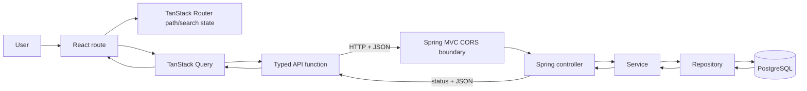

# Spec 007 — React Frontend Integration

## Goal

Add a separate React and TypeScript frontend that consumes the existing Spring Boot HTTP/JSON API.

The frontend should let a user:

- view a paginated task list;
- filter tasks by completion status and project;
- search tasks by title;
- navigate between pages;
- create a task under an existing project;
- update a task's title and completion status;
- delete a task; and
- see useful loading, empty, and error states.

Use Vite for the frontend build and development environment, TanStack Router for client-side routing and URL search state, and TanStack Query for server state.

The main request flow becomes:

```text
Browser UI
    -> typed frontend API function
    -> HTTP request across origins during development
    -> Spring Boot controller
    -> service -> repository -> PostgreSQL
    -> JSON response
    -> TanStack Query cache
    -> React UI
```

This is a learning-focused integration phase. The goal is to understand the boundary between a browser application and a backend API, not to build a polished design system or a generic frontend framework.

## Context

Specs 001–006 produced a PostgreSQL-backed Spring Boot API with:

- project creation and retrieval;
- task creation under a project;
- task retrieval, partial update, and deletion;
- an explicit task response DTO containing `id`, `title`, `completed`, and `projectId`;
- paginated task listing;
- completion, project, and title filters;
- allowlisted sorting;
- validation errors and not-found errors using a shared `ApiError` shape; and
- controller -> service -> repository boundaries.

The current relevant API contract is:

| Method | Path | Purpose |
| --- | --- | --- |
| `GET` | `/tasks` | List, filter, sort, search, and paginate tasks |
| `GET` | `/tasks/{id}` | Retrieve one task |
| `POST` | `/projects/{projectId}/tasks` | Create a task under a project |
| `PATCH` | `/tasks/{id}` | Update a task title and/or completion status |
| `DELETE` | `/tasks/{id}` | Delete a task |
| `GET` | `/projects` | List projects for names and selection controls |

`GET /tasks` accepts `page`, `size`, `completed`, `projectId`, `title`, `sortBy`, and `direction`. It returns:

```json
{
  "content": [
    {
      "id": 12,
      "title": "Build the React client",
      "completed": false,
      "projectId": 3
    }
  ],
  "page": 0,
  "size": 20,
  "numberOfElements": 1,
  "totalElements": 1,
  "totalPages": 1,
  "first": true,
  "last": true
}
```

Backend errors use:

```json
{
  "status": 400,
  "message": "Validation failed",
  "fieldErrors": {
    "title": "Title is required"
  }
}
```

The frontend and backend are separate applications. During development, Vite will normally run at `http://localhost:5173` and Spring Boot at `http://localhost:8080`. Because those URLs have different origins, the browser will enforce CORS even though both applications run on the same computer.

## Requirements

### Frontend application

Create a new frontend application in:

```text
frontend/
```

Use:

- React;
- TypeScript;
- Vite;
- TanStack Query; and
- TanStack Router.

Keep `backend/` as the Spring Boot application. The two applications must have independent build tools and development processes. Do not place frontend source files in Spring Boot's static-resource directory in this spec.

The frontend should be runnable with the normal package scripts generated or defined for the Vite application, including at least development and production build scripts. Use one package manager consistently and commit its lockfile.

### Routing

Use TanStack Router for actual application navigation rather than installing it without a meaningful role.

Provide these routes:

| Route | Purpose |
| --- | --- |
| `/` | Redirect to `/tasks` |
| `/tasks` | Paginated task list, filters, search, sorting, and deletion |
| `/tasks/new` | Create a task under a selected project |
| `/tasks/$taskId/edit` | Edit one task's title and completion status |

File-based TanStack Router routes are recommended for this spec because route files make the small route hierarchy visible. If the Vite router plugin generates a route-tree file, treat that file as generated output and do not manually maintain it.

The task list's shareable state should live in the `/tasks` URL search parameters:

- `page`;
- `size`;
- `completed` when selected;
- `projectId` when selected;
- `title` when non-blank;
- `sortBy`; and
- `direction`.

Validate and normalize route search values before using them. Invalid or absent frontend search values should fall back to the frontend defaults rather than producing `NaN`, impossible select values, or unstable query keys. The frontend defaults must agree with the backend contract: page `0`, size `20`, sort field `id`, and direction `asc`.

The browser may display page numbers as one-based labels (`Page 1`, `Page 2`) while sending zero-based page values to the backend. This translation must remain explicit.

Changing a filter, search term, page size, or sort option must reset `page` to `0`. Previous and next navigation changes only the page while preserving the other active search parameters.

To keep searching beginner-friendly, a small filter form with an **Apply filters** action is sufficient. It may keep draft input in local component state and write normalized values to the URL on submit. Debouncing is not required.

### TanStack Query setup

Create one `QueryClient` near the application root and provide it through `QueryClientProvider`. Configure the router at the same application boundary. Do not create a new query client during each render.

Use TanStack Query for data that originates from the backend:

- the paginated task list;
- one task on the edit route;
- the project list; and
- create, update, and delete operations.

Do not copy query results into component state merely to make them accessible. Form draft values and filter input are local/client state; API resources and request status are server state.

Use deliberate query keys. A suitable conceptual structure is:

```text
['tasks', 'list', normalizedListParameters]
['tasks', 'detail', taskId]
['projects', 'list']
```

Every value that can change the task-list response must be represented in its query key. Equivalent normalized requests should produce equivalent keys. Do not use one constant `['tasks']` key for every page and filter combination.

When moving between pages, preserving the previous page while the next page loads is recommended if it can be implemented clearly with TanStack Query's current placeholder-data approach. The UI must still indicate that a new request is in progress and must not present stale page metadata as if it were the new response.

Do not add Redux, Zustand, React Context for ordinary page state, or another server-state library. TanStack Query owns remote data; TanStack Router owns route/search state; React state owns temporary form values.

### Typed API boundary

Keep HTTP details outside presentational route markup. Define small typed API functions for the existing backend operations, conceptually:

```text
getTasks(parameters)
getTask(taskId)
getProjects()
createTask(projectId, request)
updateTask(taskId, request)
deleteTask(taskId)
```

Define explicit frontend types for:

- `Task`;
- `TaskPage`;
- `Project`;
- `CreateTaskInput`;
- `UpdateTaskInput`;
- task-list parameters; and
- `ApiError`.

Request and response types should remain distinct even when some fields currently overlap. For example, `CreateTaskInput` contains only `title`, while a returned `Task` also contains its generated ID, completion status, and project ID. `UpdateTaskInput` contains optional client-editable fields and must not expose `id` or `projectId` as updateable values.

Use the API base URL from a Vite environment variable such as:

```text
VITE_API_BASE_URL=http://localhost:8080
```

Provide an example environment file or clear setup documentation, but do not commit secrets. Values prefixed with `VITE_` are included in browser code and must never contain database credentials or other secrets.

Use the browser `fetch` API unless a concrete need for another HTTP client appears. A small shared request helper may:

- prepend the configured base URL;
- set JSON headers when a body is present;
- serialize request JSON;
- parse successful JSON responses;
- handle `204 No Content` without attempting JSON parsing; and
- throw a useful typed application error for non-2xx responses.

Keep this helper small. Do not build a generic SDK, repository layer, class-based API service, or generated client.

`fetch` does not reject its promise for HTTP `400`, `404`, or `500` responses. The API layer must check `response.ok` and turn unsuccessful responses into an error that components and mutations can handle. It must also produce a sensible fallback error if the response is unreachable or does not contain the expected `ApiError` JSON.

TypeScript annotations describe what the frontend expects; they do not validate JSON at runtime and are not derived automatically from Java classes. Runtime schema validation is not required in this spec, but the learner must understand this limitation.

### Task list

The `/tasks` route must request and display one backend page. Each visible task must show at least:

- title;
- completed/incomplete status;
- project name where the project list is available; and
- edit and delete actions.

The task response contains only `projectId`, while `GET /projects` supplies project names. Build a simple lookup from project ID to project name for display. Do not change the backend to embed project objects in every task response solely for this screen. If a project name cannot be resolved, showing the project ID or a clear fallback is preferable to hiding the task.

Provide controls for:

- title search;
- completion status: all, incomplete, or complete;
- project: all projects or one project;
- page size using a small set of valid values within the backend's `1..100` range;
- sort field: `id`, `title`, or `completed`; and
- sort direction: `asc` or `desc`.

The controls must send the existing backend parameter names and semantics. Do not filter, sort, search, or paginate only the current page in browser memory. The backend remains responsible for selecting the complete matching result set and returning one page.

Display useful pagination information such as the user-facing current page, total pages, and total matching tasks. Disable previous navigation on the first page and next navigation on the last page. A zero-page empty response must not display an impossible label such as “Page 1 of 0”; use an explicit empty-result presentation.

### Create task

The `/tasks/new` route must:

- load the existing project list;
- let the user choose one project;
- accept a task title;
- call `POST /projects/{projectId}/tasks` with `{ "title": ... }`;
- prevent accidental repeat submissions while the mutation is pending;
- display backend validation or request errors; and
- navigate to the task list after a successful creation.

No project-creation UI is required. If there are no projects, explain that a project is required and disable task submission rather than sending an invalid request.

The backend is authoritative for validation. Basic matching client checks, such as required title and maximum length, are useful for immediate feedback, but they must not replace handling a backend `400 ApiError`.

After success, invalidate task-list queries so any affected list is refreshed when viewed. Do not attempt to manually insert the new task into every cached page/filter/sort combination.

### Update task

The `/tasks/$taskId/edit` route must load the current task and allow the user to change:

- `title`; and
- `completed`.

Project reassignment remains unsupported because the existing PATCH contract does not allow it. Displaying the current project name is useful, but the project must not be editable on this screen.

Submit only fields accepted by `PATCH /tasks/{id}`. Disable repeat submission while pending and display backend validation/not-found/request errors.

After success:

- invalidate task-list queries because the task may enter or leave the active filters or move within the active sort order;
- invalidate or update the matching task-detail query; and
- return to the task list or otherwise make the successful result clear.

Do not add optimistic updates in this first integration spec. Waiting for server confirmation keeps rollback and conflict behavior out of the current learning scope.

### Delete task

Allow deletion from the task list. A simple browser confirmation is sufficient; a custom modal is not required.

While deletion is pending, prevent repeated deletion of the same task. After a successful `204 No Content` response, invalidate task-list queries and remove or invalidate the deleted task's detail query as appropriate.

Show a useful error if deletion fails. The task should not disappear permanently from the UI before the backend confirms success.

### Loading, empty, error, and background states

Every query-backed screen must deliberately distinguish the states relevant to it.

At minimum, handle:

- initial task-list loading;
- initial project-list loading where project data is required;
- task-detail loading;
- an empty task database;
- no tasks matching active filters;
- a task-detail `404`;
- backend validation errors;
- other backend errors;
- network/unreachable-backend errors; and
- pending create, update, and delete mutations.

Initial loading and background refetching are not identical. Avoid replacing an already useful screen with a full loading message for every background refresh. A small “refreshing” indication is sufficient when cached data remains visible.

Error UIs should provide a retry action where retrying makes sense. Do not hide all errors in the console or show only `[object Object]`.

### Backend validation errors

For a validation response:

```json
{
  "status": 400,
  "message": "Validation failed",
  "fieldErrors": {
    "title": "Title is required"
  }
}
```

display `fieldErrors.title` near the title input. For errors without a matching field entry, display the top-level `message` in a form-level error area.

Frontend validation improves usability; backend validation protects the API regardless of client. The frontend must not assume that a disabled button or TypeScript type makes an HTTP request valid.

### CORS configuration

Configure CORS in the Spring Boot backend so the Vite development origin can call the API directly from the browser.

Use one centralized Spring MVC CORS configuration rather than repeating `@CrossOrigin` on every controller. For development, allow the exact frontend origin (normally `http://localhost:5173`) for the existing API paths and required methods:

- `GET`;
- `POST`;
- `PATCH`;
- `DELETE`; and
- preflight `OPTIONS` as needed by the browser.

Allow the request headers needed for JSON, including `Content-Type`. Credentials are not needed because this phase has no authentication or cookies.

Keep the allowed origin configurable if it can be done simply, but do not introduce a large environment/profile system solely for CORS. Do not use `*` as a thoughtless production policy. Do not disable browser security, install a browser extension, or use Vite's development proxy as a substitute for learning and configuring CORS in this spec.

The learner should observe that some cross-origin requests trigger an `OPTIONS` preflight and that Spring must return the appropriate CORS response headers before the browser permits the actual request.

### Preserve backend behavior

Do not redesign backend resources or response bodies for frontend convenience. Preserve:

- all existing endpoint paths and methods;
- zero-based backend pagination;
- task and project DTO shapes;
- validation rules and `ApiError` responses;
- project ownership during task creation;
- update semantics;
- task not-found behavior;
- filtering, search, and sorting behavior;
- PostgreSQL/JPA/Flyway behavior; and
- controller -> service -> repository boundaries.

The expected backend application change is centralized CORS configuration. Make another backend change only if integration reveals a genuine defect in the established contract, and document why it is required before changing behavior.

### Verification

Verify the application with both development servers running and PostgreSQL available. Use the browser UI and browser developer tools to inspect requests, query strings, response bodies, statuses, and CORS headers.

Automated frontend test infrastructure is not a required new topic in this spec. A production TypeScript/Vite build must pass, and focused tests may be added if they protect meaningful behavior without delaying the integration lessons.

## Constraints

- Keep `frontend/` and `backend/` as separate applications.
- Use React, TypeScript, and Vite.
- Use TanStack Query for server state.
- Use TanStack Router for navigation and task-list URL search state.
- Use the existing Spring Boot API rather than mocking it for final verification.
- Keep API functions and frontend API types explicit and small.
- Configure backend CORS centrally and narrowly for local development.
- Keep the UI simple, accessible, and functional; ordinary HTML controls and modest CSS are sufficient.
- Do not add authentication or authorization.
- Do not add Redux, Zustand, MobX, or another global state library unless a later requirement genuinely needs one.
- Do not add Next.js, Remix, SSR, React Server Components, or another frontend framework.
- Do not generate an OpenAPI client yet.
- Do not add WebSockets, polling, or real-time synchronization.
- Do not add a component library or design system unless a concrete need appears; none is expected.
- Do not add a form library solely for these two small forms.
- Do not add Axios unless a concrete limitation of `fetch` is identified; none is expected.
- Do not add runtime schema libraries as a hidden substitute for understanding the API contract; runtime validation can be a later topic.
- Do not implement optimistic mutations in this phase.
- Do not create project-management screens; projects are read to support task display, filtering, and creation.
- Do not implement project reassignment because the backend contract does not support it.
- Do not duplicate backend filtering, searching, sorting, or pagination over the current page in the browser.
- Do not create generic API repositories, generic CRUD hooks, generic forms, or unnecessary wrapper components.
- Do not redesign backend DTOs or endpoints merely to simplify one React component.
- Do not place secrets in `VITE_` environment variables.
- Do not implement application code as part of writing this specification; the learner will implement it incrementally.

## Learning Objectives

By completing this spec, the learner should understand:

1. **Frontend/backend separation** — why React and Spring Boot are independent applications with separate runtimes, dependencies, builds, and responsibilities.
2. **The HTTP boundary** — how a user action becomes an HTTP request and how JSON, status codes, and headers become frontend data or errors.
3. **Browser API consumption** — how `fetch`, URLs, query strings, methods, headers, bodies, and response parsing work together.
4. **CORS** — why the browser restricts cross-origin requests, why this is a browser policy rather than a server-to-server limitation, and how the backend opts in safely.
5. **Origins** — how scheme, host, and port define an origin and why ports `5173` and `8080` make these local applications cross-origin.
6. **Preflight requests** — why the browser may send `OPTIONS` before JSON `POST`, `PATCH`, or `DELETE` requests.
7. **CORS versus authentication** — why allowing an origin to call an API does not identify a user or authorize an action.
8. **Server state** — why API resources are asynchronous, remotely owned, cacheable values that can become stale.
9. **Client state** — why form drafts, confirmation state, and temporary UI choices differ from backend-owned resources.
10. **TanStack Query** — how queries coordinate loading, errors, cached data, refetching, and stale data without manually reproducing those mechanisms.
11. **Query keys** — how a key identifies one cached result and why every page/filter/sort input must participate in the task-list key.
12. **Normalized keys** — why semantically equivalent inputs should not accidentally create different cache entries.
13. **Queries versus mutations** — why reads describe retrievable server state while create, update, and delete operations change it.
14. **Mutation lifecycle** — how pending, success, and error states affect form controls and user feedback.
15. **Cache invalidation** — why a successful write can make several cached task lists stale and why invalidating is safer than editing every possible cached page manually.
16. **No optimistic update yet** — why waiting for server success avoids rollback complexity during the first integration phase.
17. **TanStack Router** — how route paths select screens and how route parameters identify a task.
18. **URL search state** — why filters and pagination in the URL are refresh-safe, bookmarkable, shareable, and compatible with browser history.
19. **Typed API functions** — how request and response types make the frontend/backend contract visible at one boundary.
20. **Request versus response models** — why create, update, and returned-resource types have different allowed fields.
21. **Java types versus TypeScript types** — why `TaskResponse` in Java and `Task` in TypeScript are separate declarations that happen to describe the same JSON contract.
22. **JSON type conversion** — why a Java `Long` is received as a JavaScript `number`, why Java classes and methods are not sent over JSON, and why Java generics do not appear at runtime in the browser.
23. **Static types versus runtime data** — why a TypeScript annotation does not inspect or guarantee an HTTP response.
24. **HTTP error handling** — why `fetch` resolves normally for HTTP error statuses and why the client must check `response.ok`.
25. **Backend validation errors** — how `fieldErrors` becomes field-level feedback and why the server remains the validation authority.
26. **Loading, empty, and error states** — why they represent different user situations and should not be collapsed into a blank screen.
27. **Initial load versus background fetch** — why existing cached data can remain useful while a refresh is in progress.
28. **Frontend pagination** — how UI page controls become zero-based API parameters and how backend metadata controls navigation.
29. **Server-side filtering and sorting** — why operating on only the visible page in React would produce incorrect global results.
30. **Joining display data in the frontend** — how `Task.projectId` can be matched with the project list without changing the backend response graph.
31. **Environment configuration** — why an API base URL varies by environment and why browser-exposed environment variables cannot contain secrets.
32. **Integration debugging** — how browser network tools distinguish frontend rendering bugs, failed HTTP requests, backend validation, server errors, and CORS failures.

TypeScript/Node comparison: the frontend API types may look similar to shared types in a TypeScript monorepo, but this backend is Java and sends only JSON. There is no compiler checking both declarations together. Until an API schema and generated client are introduced, keeping the Java DTOs and TypeScript types aligned is a deliberate maintenance responsibility.

## Expected Frontend/Backend Architecture

Keep the frontend structure small and feature-oriented. One reasonable target is:

```text
java-fullstack/
├── backend/
│   └── src/main/java/com/example/backend/
│       ├── config/
│       │   └── WebConfig.java              # centralized CORS configuration
│       ├── error/
│       ├── project/
│       └── task/
├── frontend/
│   ├── src/
│   │   ├── api/
│   │   │   ├── client.ts                   # base URL, JSON, ApiError handling
│   │   │   ├── projects.ts                 # project API functions/types
│   │   │   └── tasks.ts                    # task API functions/types
│   │   ├── routes/
│   │   │   ├── __root.tsx                  # shared layout
│   │   │   ├── index.tsx                   # redirect to /tasks
│   │   │   ├── tasks.index.tsx             # list/filter/page/delete
│   │   │   ├── tasks.new.tsx               # create form
│   │   │   └── tasks.$taskId.edit.tsx       # update form
│   │   ├── main.tsx                        # providers and router setup
│   │   └── styles.css
│   ├── .env.example
│   ├── package.json
│   ├── tsconfig.json
│   └── vite.config.ts
└── docs/
```

Exact filenames may follow the current TanStack Router file-route conventions. Avoid splitting a small route into many hooks and components before duplication or complexity makes that extraction useful. A shared task form is optional, not required; create and update have meaningfully different inputs and behavior.

Responsibilities:

| Component | Responsibility |
| --- | --- |
| React route components | Render screens, own temporary form state, and connect user actions to queries/mutations |
| TanStack Router | Select routes, bind path parameters, validate URL search state, and navigate |
| TanStack Query | Cache backend data and expose query/mutation lifecycle state |
| Typed API functions | Construct HTTP requests, parse successful responses, and translate HTTP failures |
| Spring CORS configuration | Permit the known frontend development origin and required API methods/headers |
| Existing Spring controllers/services/repositories | Preserve the established API and application behavior |
| PostgreSQL | Remain the source of truth for project and task data |



Data ownership should remain explicit:

```text
URL path/search parameters -> TanStack Router
API resources and request status -> TanStack Query
temporary input drafts -> React component state
persistent projects/tasks -> Spring Boot + PostgreSQL
```

## Functional Acceptance Criteria

The spec is functionally complete when all of the following are verified:

1. A React + TypeScript Vite application exists under `frontend/` and its production build succeeds.
2. The frontend and backend start independently on separate local origins.
3. The frontend API base URL comes from Vite environment configuration rather than being repeated across components.
4. Spring Boot centrally permits the configured Vite development origin and does not require `@CrossOrigin` on each controller.
5. Browser requests from the frontend to the backend succeed with correct CORS response headers.
6. Required preflight requests succeed for JSON mutations.
7. `/` redirects to `/tasks` through TanStack Router.
8. Direct navigation and browser refresh work for `/tasks`, `/tasks/new`, and `/tasks/$taskId/edit` in the Vite development server.
9. `/tasks` requests the backend's default or URL-selected page using all active parameters.
10. The task-list query key changes when page, size, completion, project, title, sort field, or direction changes.
11. Equivalent normalized list parameters do not create accidental duplicate query identities.
12. The UI displays each task's title, completion status, and project name or a clear project fallback.
13. Project options are loaded from `GET /projects`, not hard-coded.
14. Title search reaches the backend and supports the existing case-insensitive substring behavior.
15. Completion and project filters reach the backend and can be combined with title search.
16. Sorting uses only `id`, `title`, and `completed` and supports both existing directions.
17. Applying a filter, search, page-size, or sort change resets the backend page to `0`.
18. Active list state is represented in URL search parameters and survives refresh and link sharing.
19. Previous and next controls preserve active filters and are disabled according to `first` and `last`.
20. The UI clearly translates zero-based API pages into understandable user-facing page labels.
21. An empty database and a filtered query with no matches show useful empty states rather than errors.
22. Initial loading, background fetching, and request failure are visibly distinguishable.
23. A task can be created with an existing project and valid title through `POST /projects/{projectId}/tasks`.
24. Task creation is disabled when no project can be selected and cannot be submitted repeatedly while pending.
25. Successful creation invalidates task-list data and returns the user to a useful screen.
26. A task edit route loads the selected task and supports title and completion updates.
27. The edit UI does not offer project reassignment.
28. Successful update invalidates affected list and detail data so filtered and sorted views become accurate.
29. A task can be deleted after confirmation, and the UI waits for backend success before treating it as deleted.
30. Successful deletion handles `204 No Content` without a JSON parsing error and refreshes task-list data.
31. Backend title validation errors appear next to the title field on create and update forms.
32. Top-level API, not-found, malformed-response, and network errors produce understandable UI messages.
33. A missing edit-route task produces a deliberate not-found/error screen rather than an endless loader or crash.
34. Query and mutation logic uses typed API functions rather than duplicating raw `fetch` calls throughout JSX.
35. Frontend types represent the current task page, project, request, and `ApiError` JSON contracts.
36. No frontend-only filtering, sorting, or pagination incorrectly replaces the backend query behavior.
37. Existing backend endpoints, DTOs, validation, persistence, and query behavior remain unchanged apart from required CORS configuration.
38. No authentication, global state library, SSR framework, generated API client, WebSocket, or unnecessary abstraction is introduced.

## Learning Acceptance Criteria

The spec is complete only when the learner can explain, in their own words:

1. Why the Vite and Spring Boot applications have separate dependencies, processes, ports, and build outputs.
2. The full flow from a button click in React to PostgreSQL and back to rendered UI.
3. What makes `http://localhost:5173` and `http://localhost:8080` different origins.
4. Why the same backend request may work in an API client but fail in a browser when CORS is missing.
5. What a CORS preflight is and which side must provide the permission response.
6. Why CORS is not authentication and why allowing one origin does not authorize users.
7. Which values in this application are server state, router state, and local component state.
8. Why task query results belong in TanStack Query rather than being copied into a global store.
9. What one task-list query key identifies.
10. Why page and every active filter/sort value belong in that query key.
11. What bug would result from using the same query key for all task pages.
12. The difference between a query and a mutation.
13. Why create, update, and delete make cached task lists potentially stale.
14. Why invalidation is simpler and safer here than manually editing every cached filtered page.
15. Why optimistic updates are deliberately postponed.
16. Why list filters and pagination are stored in URL search parameters instead of only component state.
17. How route path parameters differ from route search parameters.
18. Why changing a filter resets the page to zero.
19. How a one-based label in the UI maps to the backend's zero-based page number.
20. Why the browser must send filters to the backend rather than filtering only `content` from one page.
21. Why `Task`, `CreateTaskInput`, and `UpdateTaskInput` should not be one broad type.
22. Why a Java `TaskResponse` does not automatically create or verify a TypeScript `Task` type.
23. What information is lost or transformed when Java objects are serialized as JSON.
24. Why `response.json() as Task` or a generic return annotation provides compile-time help but no runtime proof.
25. Why `fetch` requires an explicit `response.ok` check for `400`, `404`, and `500` statuses.
26. How a backend `ApiError.fieldErrors.title` becomes field-level UI feedback.
27. Why client-side validation improves usability but cannot replace backend validation.
28. The difference between initial loading, background refetching, an empty result, and a failed request.
29. Why the project list is a separate query and how project IDs are translated into display names.
30. Why `204 No Content` must not be parsed as JSON.
31. Why a `VITE_` variable can configure a public API URL but must not contain database credentials.
32. How to use the browser network panel to identify an incorrect URL, wrong query parameter, backend `ApiError`, server failure, network failure, or CORS rejection.

The learner should also be able to sketch the component/router/query/API/backend boundaries, predict which query key a filtered page uses, and describe which cached data must be invalidated after each mutation before considering Spec 007 complete.

## Suggested Implementation Order

Implement one meaningful step at a time:

1. Run the existing backend, call the relevant endpoints manually, and write down the exact successful and error JSON contracts the frontend will consume.
2. Scaffold `frontend/` with Vite's React + TypeScript template, run it independently, and remove only the unnecessary template content.
3. Install and configure TanStack Router; add the root layout, `/` redirect, and placeholder list/create/edit routes before adding API data.
4. Add one root `QueryClient` and `QueryClientProvider`; explain why the client is created once.
5. Define the frontend API contract types and compare every field with the existing Java request/response DTOs.
6. Add `VITE_API_BASE_URL`, an example environment file, and a small fetch helper that handles JSON success, `ApiError`, network failure, and `204`.
7. Configure centralized backend CORS for the exact Vite origin, then verify a simple `GET /projects` from the browser and inspect the CORS headers.
8. Implement `getProjects()` and render its initial loading, success, empty, and error states on a temporary or relevant screen.
9. Implement `getTasks(parameters)` and render the default first task page with a deliberate query key.
10. Add task-list URL search validation and connect page/size values; verify browser back, forward, refresh, and copied URLs.
11. Add title, completion, and project filter controls with an Apply action; reset page to zero and verify the actual request query string.
12. Add sorting controls and ensure every list input participates in the normalized query key.
13. Add project-name lookup, list metadata, previous/next controls, and separate unfiltered-empty and filtered-empty states.
14. Add optional previous-page placeholder behavior and a small background-fetch indicator without hiding useful cached content.
15. Build the create route with project selection and title input, then add the create mutation and pending/error/success behavior.
16. Render backend field validation beside the title input and verify that backend validation remains effective even if a request bypasses client checks.
17. Invalidate task-list queries after creation and navigate back to `/tasks`; verify that lists with different filters are not manually patched.
18. Build the edit route using the task ID path parameter and detail query; handle loading, unknown task, and network failure before adding the form.
19. Add the update mutation for title/completed only, then invalidate the detail and all task-list queries after success.
20. Add confirmed deletion from the task list, including pending state, `204` handling, failure behavior, and list invalidation.
21. Stop the backend and verify that each query/mutation screen reports an understandable network error and offers recovery where appropriate.
22. Verify direct route refreshes, all loading/error/empty states, combined filtering, every page boundary, create/update/delete effects, and project display.
23. Run the frontend production build and the existing backend checks; fix TypeScript errors without weakening types to `any`.
24. Review the implementation for duplicated fetch logic, missing query-key inputs, copied server state, frontend-only filtering, broad CORS, secrets in Vite variables, and premature abstractions.
25. Explain the complete list-query and mutation/invalidation flows before considering Spec 007 complete.
